# HRMS Universal Approval Workflows, State Transitions & Process Maps

**Document Reference:** HRMS-WF-ENGINE-2026  
**System Name:** PeopleCore Multi-Tenant HRMS SaaS  
**Architecture:** Shared Event-Driven Approval Engine (`approval_requests`, `approval_actions`, `approval_workflows`)

---

## 1. Unified Approval Engine Architecture

The platform operates on a single polymorphic approval engine shared across all modules.

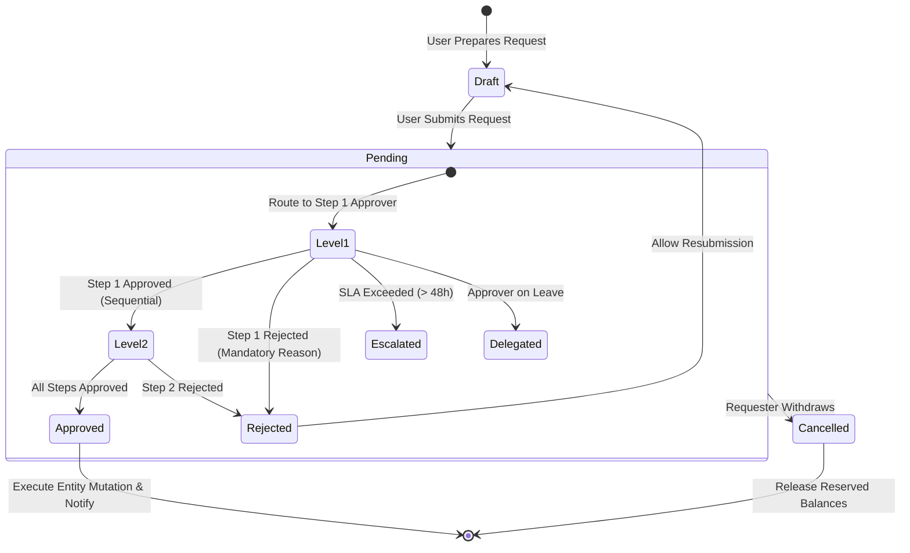

---

## 2. Global Workflow 1: Tenant Signup, Inactive Defaulting & Super Admin Activation Gate

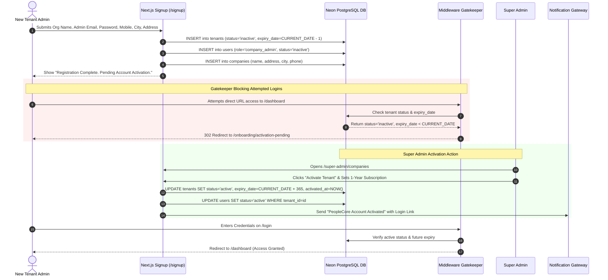

---

## 3. Global Workflow 2: Employee Creation & Role Assignment

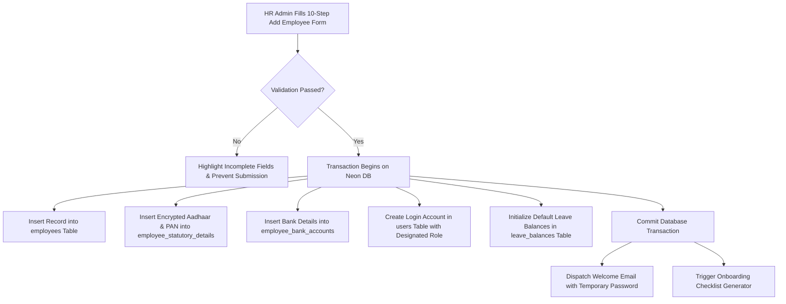

---

## 4. Global Workflow 3: Daily Attendance Regularization Flow

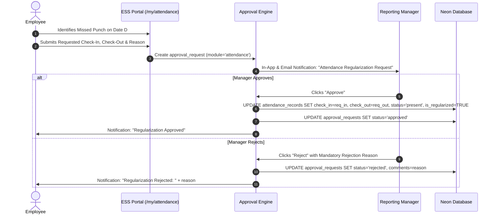

---

## 5. Global Workflow 4: Leave Application & Approval Workflow

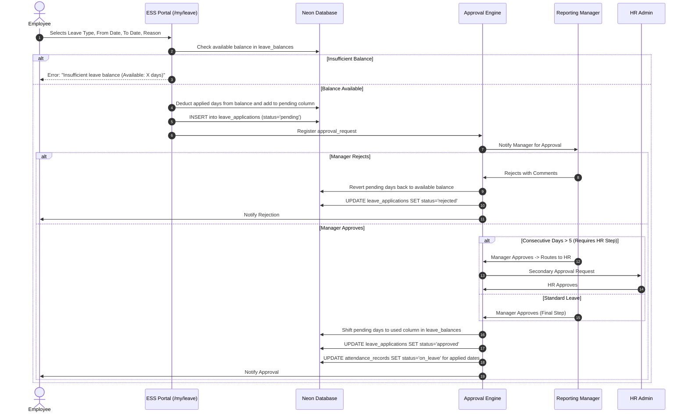

---

## 6. Global Workflow 5: Monthly Payroll Execution & Finalization

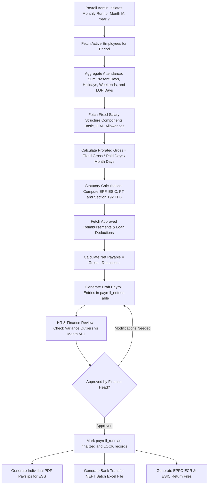

---

## 7. Global Workflow 6: Expense Claim & Reimbursement Workflow

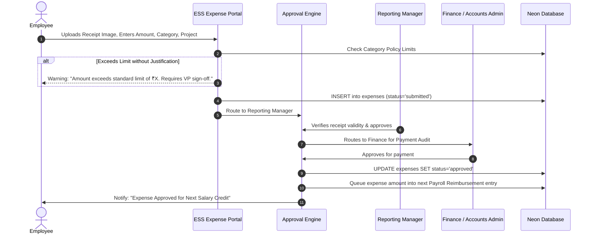

---

## 8. Global Workflow 7: Recruitment Pipeline (Requisition to Offer)

```mermaid
graph LR
    Req[Job Requisition by Dept Head] --> ReqAppr{HR / Finance Approval}
    ReqAppr -->|Approved| Post[Publish Job Opening & External Link]
    Post --> Cand[Candidate Applies / Resume Sourced]
    Cand --> Screen[Recruiter Screening & Rating]
    Screen --> Round1[Technical Interview Panel Evaluation]
    Round1 --> Round2[System Design / Managerial Round]
    Round2 --> OfferDraft[HR Drafts Job Offer Letter with CTC Breakdown]
    OfferDraft --> OfferAppr{Management Approval}
    OfferAppr -->|Approved| SendOffer[Send Digital Offer with Acceptance Deadline]
    SendOffer --> CandDec{Candidate Acceptance?}
    CandDec -->|Accepted| Onboard[Automatically Trigger Onboarding Workflow]
    CandDec -->|Declined| Archive[Archive Candidate with Decline Reason]
```

---

## 9. Global Workflow 8: Performance Appraisal Cycle

```mermaid
sequenceDiagram
    autonumber
    actor HR as HR Admin
    actor Emp as Employee
    actor Mgr as Reporting Manager
    participant App as Performance Engine

    HR->>App: Launch Annual Performance Cycle (e.g., FY26 Annual Review)
    App->>Emp: Notify: "Self-Assessment Form Open"
    Emp->>App: Submits Self-Ratings (1-5) and Goal Achievements
    App->>Mgr: Notify: "Employee Self-Assessment Submitted"
    Mgr->>App: Submits Manager Evaluation & Promotion Recommendations
    App->>HR: Review Calibration Grid (Bell Curve Normalization)
    HR->>App: Finalize Ratings & Increment %
    App->>Emp: Release Final Performance Appraisal Report
```

---

## 10. Global Workflow 9: Asset Allocation, Return & Clearance

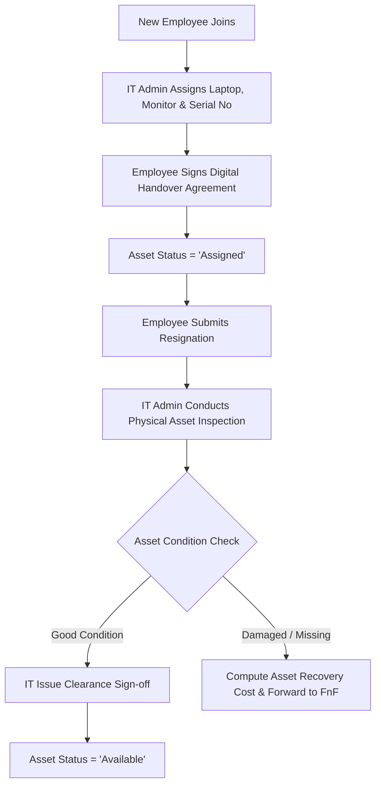

---

## 11. Global Workflow 10: Employee Resignation, Clearance & FnF Settlement

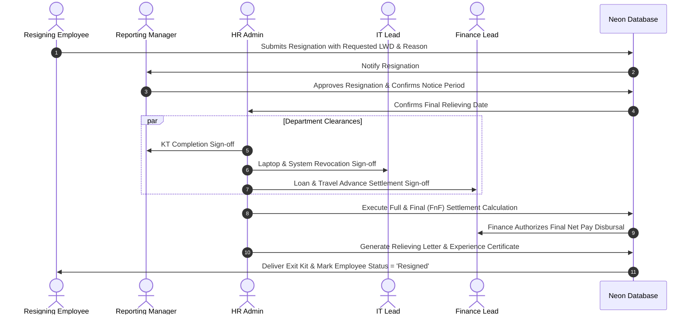

