# HRMS Database Schema, Entity Relationships & Neon PostgreSQL Specification

**System Name:** PeopleCore Enterprise Multi-Tenant HRMS  
**Database Engine:** Neon PostgreSQL (Serverless v16+)  
**Connection Modes:**
- **Direct Connection (`DATABASE_URL`):** Migrations, long-running payroll calculation jobs, and DDL operations.
- **Pooled Connection (`DATABASE_URL_POOLED`):** High-concurrency Next.js App Router queries via PgBouncer.

---

## 1. Multi-Tenant Entity Relationship Diagram (High-Level Architecture)

```mermaid
erDiagram
    TENANTS ||--o{ COMPANIES : owns
    TENANTS ||--o{ USERS : contains
    COMPANIES ||--o{ BRANCHES : operates
    COMPANIES ||--o{ DEPARTMENTS : organizes
    COMPANIES ||--o{ DESIGNATIONS : defines
    COMPANIES ||--o{ JOB_GRADES : structures
    COMPANIES ||--o{ COST_CENTRES : tracks
    TENANTS ||--o{ EMPLOYEES : employs
    
    EMPLOYEES ||--o| EMPLOYEE_PERSONAL_DETAILS : has
    EMPLOYEES ||--o{ EMPLOYEE_BANK_ACCOUNTS : maintains
    EMPLOYEES ||--o| EMPLOYEE_STATUTORY_DETAILS : complies
    EMPLOYEES ||--o{ EMPLOYEE_DOCUMENTS : owns
    EMPLOYEES ||--o{ ATTENDANCE_RECORDS : punches
    EMPLOYEES ||--o{ LEAVE_APPLICATIONS : requests
    EMPLOYEES ||--o{ LEAVE_BALANCES : holds
    
    COMPANIES ||--o{ PAYROLL_GROUPS : configures
    COMPANIES ||--o{ SALARY_STRUCTURES : defines
    SALARY_STRUCTURES ||--o{ SALARY_COMPONENTS : includes
    EMPLOYEES ||--o{ EMPLOYEE_SALARY_ASSIGNMENTS : assigned
    PAYROLL_RUNS ||--o{ PAYROLL_ENTRIES : calculates
    
    TENANTS ||--o{ JOB_OPENINGS : recruits
    JOB_OPENINGS ||--o{ JOB_APPLICATIONS : receives
    CANDIDATES ||--o{ JOB_APPLICATIONS : submits
    JOB_APPLICATIONS ||--o{ INTERVIEWS : attends
    
    TENANTS ||--o{ ASSETS : registers
    EMPLOYEES ||--o{ ASSET_ASSIGNMENTS : assigned
    EMPLOYEES ||--o{ EXPENSES : claims
    EMPLOYEES ||--o{ RESIGNATIONS : submits
    TENANTS ||--o{ APPROVAL_REQUESTS : routes
    APPROVAL_REQUESTS ||--o{ APPROVAL_ACTIONS : records
```



---

## 2. Core Tenant & Gatekeeper Schema (Mandatory Registration & Expiry Gate)

```sql
-- Enable necessary cryptographic extensions
CREATE EXTENSION IF NOT EXISTS "uuid-ossp";
CREATE EXTENSION IF NOT EXISTS "pgcrypto";

-- ============================================================
-- 1. TENANTS TABLE (With Inactive Default & Expiry Gate)
-- ============================================================
CREATE TABLE IF NOT EXISTS tenants (
  id UUID PRIMARY KEY DEFAULT gen_random_uuid(),
  name TEXT NOT NULL,
  slug TEXT NOT NULL UNIQUE,
  plan TEXT NOT NULL DEFAULT 'trial' CHECK (plan IN ('trial', 'starter', 'professional', 'enterprise')),
  status TEXT NOT NULL DEFAULT 'inactive' CHECK (status IN ('active', 'inactive', 'suspended', 'cancelled')),
  subscription_expiry_date DATE NOT NULL DEFAULT (CURRENT_DATE - INTERVAL '1 day'),
  mobile_number TEXT NOT NULL,
  city TEXT NOT NULL,
  address TEXT NOT NULL,
  industry TEXT,
  max_employees INTEGER NOT NULL DEFAULT 25,
  activated_at TIMESTAMPTZ,
  activated_by UUID,
  created_at TIMESTAMPTZ NOT NULL DEFAULT NOW(),
  updated_at TIMESTAMPTZ NOT NULL DEFAULT NOW()
);

CREATE INDEX idx_tenants_status_expiry ON tenants(status, subscription_expiry_date);
CREATE INDEX idx_tenants_slug ON tenants(slug);

-- ============================================================
-- 2. USERS (Authentication & Role Mapping)
-- ============================================================
CREATE TABLE IF NOT EXISTS users (
  id UUID PRIMARY KEY DEFAULT gen_random_uuid(),
  tenant_id UUID REFERENCES tenants(id) ON DELETE CASCADE,
  employee_id UUID, -- Foreign key linked after employee table creation
  email TEXT NOT NULL UNIQUE,
  password_hash TEXT, -- Stored when using local Neon auth or linked to Supabase/Auth0
  full_name TEXT NOT NULL,
  phone TEXT,
  role TEXT NOT NULL DEFAULT 'employee' CHECK (
    role IN ('super_admin', 'company_owner', 'company_admin', 'hr_admin', 'hr_manager', 'payroll_admin', 'recruiter', 'manager', 'employee', 'auditor')
  ),
  status TEXT NOT NULL DEFAULT 'inactive' CHECK (status IN ('active', 'inactive', 'locked')),
  last_login_at TIMESTAMPTZ,
  created_at TIMESTAMPTZ NOT NULL DEFAULT NOW(),
  updated_at TIMESTAMPTZ NOT NULL DEFAULT NOW()
);

CREATE INDEX idx_users_tenant_role ON users(tenant_id, role);
CREATE INDEX idx_users_email ON users(email);

-- ============================================================
-- 3. COMPANIES (Legal Entities within Tenant)
-- ============================================================
CREATE TABLE IF NOT EXISTS companies (
  id UUID PRIMARY KEY DEFAULT gen_random_uuid(),
  tenant_id UUID NOT NULL REFERENCES tenants(id) ON DELETE CASCADE,
  name TEXT NOT NULL,
  legal_name TEXT NOT NULL,
  registration_number TEXT, -- CIN
  pan TEXT NOT NULL,
  gstin TEXT,
  epf_code TEXT,
  esic_code TEXT,
  industry TEXT,
  website TEXT,
  email TEXT NOT NULL,
  phone TEXT NOT NULL,
  address JSONB NOT NULL DEFAULT '{}'::jsonb,
  logo_url TEXT,
  financial_year_start INTEGER NOT NULL DEFAULT 4, -- 4 = April for India
  currency TEXT NOT NULL DEFAULT 'INR',
  timezone TEXT NOT NULL DEFAULT 'Asia/Kolkata',
  status TEXT NOT NULL DEFAULT 'active' CHECK (status IN ('active', 'inactive')),
  created_at TIMESTAMPTZ NOT NULL DEFAULT NOW(),
  updated_at TIMESTAMPTZ NOT NULL DEFAULT NOW()
);

CREATE INDEX idx_companies_tenant ON companies(tenant_id);

-- ============================================================
-- 4. BRANCHES & WORK LOCATIONS
-- ============================================================
CREATE TABLE IF NOT EXISTS branches (
  id UUID PRIMARY KEY DEFAULT gen_random_uuid(),
  tenant_id UUID NOT NULL REFERENCES tenants(id) ON DELETE CASCADE,
  company_id UUID NOT NULL REFERENCES companies(id) ON DELETE CASCADE,
  name TEXT NOT NULL,
  code TEXT NOT NULL,
  state TEXT NOT NULL, -- Crucial for Indian Professional Tax slab selection
  city TEXT NOT NULL,
  address JSONB NOT NULL DEFAULT '{}'::jsonb,
  email TEXT,
  phone TEXT,
  head_id UUID, -- Assigned Branch Head (Employee ID)
  is_headquarters BOOLEAN NOT NULL DEFAULT FALSE,
  status TEXT NOT NULL DEFAULT 'active' CHECK (status IN ('active', 'inactive')),
  created_at TIMESTAMPTZ NOT NULL DEFAULT NOW(),
  updated_at TIMESTAMPTZ NOT NULL DEFAULT NOW(),
  UNIQUE(tenant_id, code)
);

CREATE INDEX idx_branches_tenant ON branches(tenant_id);
CREATE INDEX idx_branches_state ON branches(tenant_id, state);

-- ============================================================
-- 5. DEPARTMENTS & DESIGNATIONS
-- ============================================================
CREATE TABLE IF NOT EXISTS departments (
  id UUID PRIMARY KEY DEFAULT gen_random_uuid(),
  tenant_id UUID NOT NULL REFERENCES tenants(id) ON DELETE CASCADE,
  company_id UUID NOT NULL REFERENCES companies(id) ON DELETE CASCADE,
  name TEXT NOT NULL,
  code TEXT NOT NULL,
  parent_id UUID REFERENCES departments(id),
  head_id UUID, -- Department Head (Employee ID)
  description TEXT,
  status TEXT NOT NULL DEFAULT 'active' CHECK (status IN ('active', 'inactive')),
  created_at TIMESTAMPTZ NOT NULL DEFAULT NOW(),
  updated_at TIMESTAMPTZ NOT NULL DEFAULT NOW(),
  UNIQUE(tenant_id, code)
);

CREATE TABLE IF NOT EXISTS designations (
  id UUID PRIMARY KEY DEFAULT gen_random_uuid(),
  tenant_id UUID NOT NULL REFERENCES tenants(id) ON DELETE CASCADE,
  company_id UUID NOT NULL REFERENCES companies(id) ON DELETE CASCADE,
  department_id UUID REFERENCES departments(id),
  name TEXT NOT NULL,
  code TEXT NOT NULL,
  level INTEGER DEFAULT 1,
  description TEXT,
  status TEXT NOT NULL DEFAULT 'active' CHECK (status IN ('active', 'inactive')),
  created_at TIMESTAMPTZ NOT NULL DEFAULT NOW(),
  updated_at TIMESTAMPTZ NOT NULL DEFAULT NOW(),
  UNIQUE(tenant_id, code)
);

CREATE TABLE IF NOT EXISTS job_grades (
  id UUID PRIMARY KEY DEFAULT gen_random_uuid(),
  tenant_id UUID NOT NULL REFERENCES tenants(id) ON DELETE CASCADE,
  company_id UUID NOT NULL REFERENCES companies(id) ON DELETE CASCADE,
  name TEXT NOT NULL,
  code TEXT NOT NULL,
  min_salary NUMERIC(12,2),
  max_salary NUMERIC(12,2),
  description TEXT,
  status TEXT NOT NULL DEFAULT 'active' CHECK (status IN ('active', 'inactive')),
  created_at TIMESTAMPTZ NOT NULL DEFAULT NOW(),
  updated_at TIMESTAMPTZ NOT NULL DEFAULT NOW(),
  UNIQUE(tenant_id, code)
);

CREATE TABLE IF NOT EXISTS cost_centres (
  id UUID PRIMARY KEY DEFAULT gen_random_uuid(),
  tenant_id UUID NOT NULL REFERENCES tenants(id) ON DELETE CASCADE,
  company_id UUID NOT NULL REFERENCES companies(id) ON DELETE CASCADE,
  name TEXT NOT NULL,
  code TEXT NOT NULL,
  description TEXT,
  status TEXT NOT NULL DEFAULT 'active' CHECK (status IN ('active', 'inactive')),
  created_at TIMESTAMPTZ NOT NULL DEFAULT NOW(),
  updated_at TIMESTAMPTZ NOT NULL DEFAULT NOW(),
  UNIQUE(tenant_id, code)
);
```

---

## 3. Employee Master & Sub-Table Schema

```sql
-- ============================================================
-- 6. EMPLOYEES MASTER TABLE
-- ============================================================
CREATE TABLE IF NOT EXISTS employees (
  id UUID PRIMARY KEY DEFAULT gen_random_uuid(),
  tenant_id UUID NOT NULL REFERENCES tenants(id) ON DELETE CASCADE,
  company_id UUID NOT NULL REFERENCES companies(id) ON DELETE CASCADE,
  branch_id UUID REFERENCES branches(id),
  department_id UUID REFERENCES departments(id),
  designation_id UUID REFERENCES designations(id),
  job_grade_id UUID REFERENCES job_grades(id),
  cost_centre_id UUID REFERENCES cost_centres(id),
  reporting_manager_id UUID REFERENCES employees(id),
  user_id UUID REFERENCES users(id),
  employee_id TEXT NOT NULL,
  first_name TEXT NOT NULL,
  middle_name TEXT,
  last_name TEXT NOT NULL,
  date_of_birth DATE NOT NULL,
  gender TEXT CHECK (gender IN ('male', 'female', 'other', 'prefer_not_to_say')),
  marital_status TEXT CHECK (marital_status IN ('single', 'married', 'divorced', 'widowed')),
  blood_group TEXT,
  nationality TEXT DEFAULT 'Indian',
  photo_url TEXT,
  joining_date DATE NOT NULL,
  employment_type TEXT NOT NULL DEFAULT 'full_time' CHECK (employment_type IN ('full_time', 'part_time', 'contract', 'intern')),
  employment_status TEXT NOT NULL DEFAULT 'active' CHECK (employment_status IN ('active', 'probation', 'notice_period', 'terminated', 'resigned', 'on_leave')),
  probation_end_date DATE,
  confirmation_date DATE,
  notice_period_days INTEGER NOT NULL DEFAULT 30,
  work_email TEXT NOT NULL,
  personal_email TEXT,
  mobile TEXT NOT NULL,
  alternate_mobile TEXT,
  created_at TIMESTAMPTZ NOT NULL DEFAULT NOW(),
  updated_at TIMESTAMPTZ NOT NULL DEFAULT NOW(),
  deleted_at TIMESTAMPTZ, -- Soft deletion
  UNIQUE(tenant_id, employee_id),
  UNIQUE(tenant_id, work_email)
);

CREATE INDEX idx_employees_tenant_status ON employees(tenant_id, employment_status);
CREATE INDEX idx_employees_manager ON employees(reporting_manager_id);
CREATE INDEX idx_employees_dept ON employees(tenant_id, department_id);

-- Foreign key linking back to users
ALTER TABLE users ADD CONSTRAINT fk_users_employee FOREIGN KEY (employee_id) REFERENCES employees(id) ON DELETE SET NULL;

-- ============================================================
-- 7. SENSITIVE EMPLOYEE SUB-TABLES (Bank & Statutory)
-- ============================================================
CREATE TABLE IF NOT EXISTS employee_bank_accounts (
  id UUID PRIMARY KEY DEFAULT gen_random_uuid(),
  tenant_id UUID NOT NULL REFERENCES tenants(id) ON DELETE CASCADE,
  employee_id UUID NOT NULL REFERENCES employees(id) ON DELETE CASCADE,
  account_holder_name TEXT NOT NULL,
  bank_name TEXT NOT NULL,
  account_number TEXT NOT NULL,
  ifsc_code TEXT NOT NULL,
  branch_name TEXT,
  account_type TEXT DEFAULT 'savings' CHECK (account_type IN ('savings', 'current')),
  is_primary BOOLEAN NOT NULL DEFAULT TRUE,
  created_at TIMESTAMPTZ NOT NULL DEFAULT NOW(),
  updated_at TIMESTAMPTZ NOT NULL DEFAULT NOW(),
  UNIQUE(tenant_id, employee_id, account_number)
);

CREATE TABLE IF NOT EXISTS employee_statutory_details (
  id UUID PRIMARY KEY DEFAULT gen_random_uuid(),
  tenant_id UUID NOT NULL REFERENCES tenants(id) ON DELETE CASCADE,
  employee_id UUID NOT NULL REFERENCES employees(id) ON DELETE CASCADE UNIQUE,
  pan TEXT NOT NULL,
  aadhaar_last4 TEXT NOT NULL,
  aadhaar_encrypted TEXT NOT NULL, -- AES-256 encrypted payload
  uan TEXT,
  pf_member_id TEXT,
  esi_number TEXT,
  tax_regime TEXT NOT NULL DEFAULT 'new' CHECK (tax_regime IN ('new', 'old')),
  created_at TIMESTAMPTZ NOT NULL DEFAULT NOW(),
  updated_at TIMESTAMPTZ NOT NULL DEFAULT NOW()
);

CREATE TABLE IF NOT EXISTS employee_documents (
  id UUID PRIMARY KEY DEFAULT gen_random_uuid(),
  tenant_id UUID NOT NULL REFERENCES tenants(id) ON DELETE CASCADE,
  employee_id UUID NOT NULL REFERENCES employees(id) ON DELETE CASCADE,
  document_type TEXT NOT NULL,
  document_name TEXT NOT NULL,
  file_url TEXT NOT NULL,
  file_size_bytes INTEGER,
  mime_type TEXT,
  expiry_date DATE,
  verified BOOLEAN NOT NULL DEFAULT FALSE,
  verified_by UUID REFERENCES users(id),
  verified_at TIMESTAMPTZ,
  created_at TIMESTAMPTZ NOT NULL DEFAULT NOW(),
  updated_at TIMESTAMPTZ NOT NULL DEFAULT NOW()
);
```

---

## 4. Attendance & Leave Schema

```sql
-- ============================================================
-- 8. SHIFTS & ATTENDANCE RECORDS
-- ============================================================
CREATE TABLE IF NOT EXISTS shifts (
  id UUID PRIMARY KEY DEFAULT gen_random_uuid(),
  tenant_id UUID NOT NULL REFERENCES tenants(id) ON DELETE CASCADE,
  company_id UUID NOT NULL REFERENCES companies(id) ON DELETE CASCADE,
  name TEXT NOT NULL,
  code TEXT NOT NULL,
  start_time TIME NOT NULL,
  end_time TIME NOT NULL,
  grace_period_minutes INTEGER DEFAULT 15,
  half_day_hours NUMERIC(4,2) DEFAULT 4.00,
  full_day_hours NUMERIC(4,2) DEFAULT 8.00,
  is_night_shift BOOLEAN DEFAULT FALSE,
  status TEXT NOT NULL DEFAULT 'active' CHECK (status IN ('active', 'inactive')),
  created_at TIMESTAMPTZ NOT NULL DEFAULT NOW(),
  updated_at TIMESTAMPTZ NOT NULL DEFAULT NOW(),
  UNIQUE(tenant_id, code)
);

CREATE TABLE IF NOT EXISTS attendance_records (
  id UUID PRIMARY KEY DEFAULT gen_random_uuid(),
  tenant_id UUID NOT NULL REFERENCES tenants(id) ON DELETE CASCADE,
  employee_id UUID NOT NULL REFERENCES employees(id) ON DELETE CASCADE,
  shift_id UUID REFERENCES shifts(id),
  date DATE NOT NULL,
  first_check_in TIMESTAMPTZ,
  last_check_out TIMESTAMPTZ,
  working_hours NUMERIC(5,2) DEFAULT 0,
  break_duration_minutes INTEGER DEFAULT 0,
  overtime_hours NUMERIC(5,2) DEFAULT 0,
  status TEXT NOT NULL DEFAULT 'present' CHECK (status IN ('present', 'absent', 'half_day', 'on_leave', 'holiday', 'weekly_off')),
  is_regularized BOOLEAN NOT NULL DEFAULT FALSE,
  source TEXT NOT NULL DEFAULT 'web' CHECK (source IN ('web', 'mobile_gps', 'biometric', 'manual')),
  notes TEXT,
  created_at TIMESTAMPTZ NOT NULL DEFAULT NOW(),
  updated_at TIMESTAMPTZ NOT NULL DEFAULT NOW(),
  UNIQUE(tenant_id, employee_id, date)
);

CREATE INDEX idx_attendance_tenant_emp_date ON attendance_records(tenant_id, employee_id, date);

CREATE TABLE IF NOT EXISTS attendance_punches (
  id UUID PRIMARY KEY DEFAULT gen_random_uuid(),
  tenant_id UUID NOT NULL REFERENCES tenants(id) ON DELETE CASCADE,
  attendance_record_id UUID REFERENCES attendance_records(id) ON DELETE CASCADE,
  employee_id UUID NOT NULL REFERENCES employees(id) ON DELETE CASCADE,
  punch_time TIMESTAMPTZ NOT NULL DEFAULT NOW(),
  punch_type TEXT NOT NULL CHECK (punch_type IN ('in', 'out')),
  punch_mode TEXT NOT NULL DEFAULT 'web' CHECK (punch_mode IN ('web', 'mobile', 'biometric', 'manual')),
  latitude NUMERIC(10, 7),
  longitude NUMERIC(10, 7),
  location_name TEXT,
  device_info TEXT,
  created_at TIMESTAMPTZ NOT NULL DEFAULT NOW()
);

-- ============================================================
-- 9. LEAVE POLICIES, BALANCES & APPLICATIONS
-- ============================================================
CREATE TABLE IF NOT EXISTS leave_types (
  id UUID PRIMARY KEY DEFAULT gen_random_uuid(),
  tenant_id UUID NOT NULL REFERENCES tenants(id) ON DELETE CASCADE,
  company_id UUID NOT NULL REFERENCES companies(id) ON DELETE CASCADE,
  name TEXT NOT NULL,
  code TEXT NOT NULL,
  annual_allocation NUMERIC(4,1) NOT NULL DEFAULT 12.0,
  accrual_frequency TEXT DEFAULT 'monthly' CHECK (accrual_frequency IN ('yearly', 'monthly', 'quarterly')),
  carry_forward_limit NUMERIC(4,1) DEFAULT 0,
  encashable BOOLEAN DEFAULT FALSE,
  is_paid BOOLEAN DEFAULT TRUE,
  sandwich_rule_applicable BOOLEAN DEFAULT FALSE,
  status TEXT NOT NULL DEFAULT 'active' CHECK (status IN ('active', 'inactive')),
  created_at TIMESTAMPTZ NOT NULL DEFAULT NOW(),
  updated_at TIMESTAMPTZ NOT NULL DEFAULT NOW(),
  UNIQUE(tenant_id, code)
);

CREATE TABLE IF NOT EXISTS leave_balances (
  id UUID PRIMARY KEY DEFAULT gen_random_uuid(),
  tenant_id UUID NOT NULL REFERENCES tenants(id) ON DELETE CASCADE,
  employee_id UUID NOT NULL REFERENCES employees(id) ON DELETE CASCADE,
  leave_type_id UUID NOT NULL REFERENCES leave_types(id) ON DELETE CASCADE,
  year INTEGER NOT NULL,
  allocated NUMERIC(5,2) NOT NULL DEFAULT 0,
  carried_forward NUMERIC(5,2) NOT NULL DEFAULT 0,
  used NUMERIC(5,2) NOT NULL DEFAULT 0,
  pending NUMERIC(5,2) NOT NULL DEFAULT 0,
  balance NUMERIC(5,2) GENERATED ALWAYS AS (allocated + carried_forward - used - pending) STORED,
  created_at TIMESTAMPTZ NOT NULL DEFAULT NOW(),
  updated_at TIMESTAMPTZ NOT NULL DEFAULT NOW(),
  UNIQUE(tenant_id, employee_id, leave_type_id, year)
);

CREATE TABLE IF NOT EXISTS leave_applications (
  id UUID PRIMARY KEY DEFAULT gen_random_uuid(),
  tenant_id UUID NOT NULL REFERENCES tenants(id) ON DELETE CASCADE,
  employee_id UUID NOT NULL REFERENCES employees(id) ON DELETE CASCADE,
  leave_type_id UUID NOT NULL REFERENCES leave_types(id),
  from_date DATE NOT NULL,
  to_date DATE NOT NULL,
  total_days NUMERIC(5,2) NOT NULL,
  is_half_day BOOLEAN NOT NULL DEFAULT FALSE,
  half_day_session TEXT CHECK (half_day_session IN ('morning', 'afternoon')),
  reason TEXT NOT NULL,
  status TEXT NOT NULL DEFAULT 'pending' CHECK (status IN ('pending', 'approved', 'rejected', 'cancelled')),
  approver_id UUID REFERENCES users(id),
  approved_at TIMESTAMPTZ,
  rejection_reason TEXT,
  created_at TIMESTAMPTZ NOT NULL DEFAULT NOW(),
  updated_at TIMESTAMPTZ NOT NULL DEFAULT NOW()
);
```

---

## 5. Payroll Management Schema (India Statutory Engine)

```sql
-- ============================================================
-- 10. PAYROLL CONFIGURATION & RUNS
-- ============================================================
CREATE TABLE IF NOT EXISTS payroll_groups (
  id UUID PRIMARY KEY DEFAULT gen_random_uuid(),
  tenant_id UUID NOT NULL REFERENCES tenants(id) ON DELETE CASCADE,
  company_id UUID NOT NULL REFERENCES companies(id) ON DELETE CASCADE,
  name TEXT NOT NULL,
  disbursal_day INTEGER NOT NULL DEFAULT 28,
  currency TEXT NOT NULL DEFAULT 'INR',
  status TEXT NOT NULL DEFAULT 'active',
  created_at TIMESTAMPTZ NOT NULL DEFAULT NOW(),
  updated_at TIMESTAMPTZ NOT NULL DEFAULT NOW()
);

CREATE TABLE IF NOT EXISTS salary_components (
  id UUID PRIMARY KEY DEFAULT gen_random_uuid(),
  tenant_id UUID NOT NULL REFERENCES tenants(id) ON DELETE CASCADE,
  company_id UUID NOT NULL REFERENCES companies(id) ON DELETE CASCADE,
  name TEXT NOT NULL,
  code TEXT NOT NULL,
  type TEXT NOT NULL CHECK (type IN ('earning', 'deduction', 'statutory_deduction', 'statutory_contribution')),
  calculation_type TEXT NOT NULL DEFAULT 'fixed' CHECK (calculation_type IN ('fixed', 'percentage_of_basic', 'formula')),
  formula_expression TEXT,
  is_taxable BOOLEAN NOT NULL DEFAULT TRUE,
  status TEXT NOT NULL DEFAULT 'active',
  created_at TIMESTAMPTZ NOT NULL DEFAULT NOW(),
  updated_at TIMESTAMPTZ NOT NULL DEFAULT NOW(),
  UNIQUE(tenant_id, code)
);

CREATE TABLE IF NOT EXISTS salary_structures (
  id UUID PRIMARY KEY DEFAULT gen_random_uuid(),
  tenant_id UUID NOT NULL REFERENCES tenants(id) ON DELETE CASCADE,
  company_id UUID NOT NULL REFERENCES companies(id) ON DELETE CASCADE,
  name TEXT NOT NULL,
  description TEXT,
  status TEXT NOT NULL DEFAULT 'active',
  created_at TIMESTAMPTZ NOT NULL DEFAULT NOW(),
  updated_at TIMESTAMPTZ NOT NULL DEFAULT NOW()
);

CREATE TABLE IF NOT EXISTS salary_structure_components (
  id UUID PRIMARY KEY DEFAULT gen_random_uuid(),
  salary_structure_id UUID NOT NULL REFERENCES salary_structures(id) ON DELETE CASCADE,
  salary_component_id UUID NOT NULL REFERENCES salary_components(id) ON DELETE CASCADE,
  percentage_or_value NUMERIC(12,4),
  sort_order INTEGER DEFAULT 1
);

CREATE TABLE IF NOT EXISTS employee_salary_assignments (
  id UUID PRIMARY KEY DEFAULT gen_random_uuid(),
  tenant_id UUID NOT NULL REFERENCES tenants(id) ON DELETE CASCADE,
  employee_id UUID NOT NULL REFERENCES employees(id) ON DELETE CASCADE,
  salary_structure_id UUID REFERENCES salary_structures(id),
  annual_ctc NUMERIC(12,2) NOT NULL,
  monthly_gross NUMERIC(12,2) NOT NULL,
  basic_salary NUMERIC(12,2) NOT NULL,
  hra NUMERIC(12,2) NOT NULL,
  special_allowance NUMERIC(12,2) NOT NULL,
  effective_date DATE NOT NULL,
  is_current BOOLEAN NOT NULL DEFAULT TRUE,
  created_at TIMESTAMPTZ NOT NULL DEFAULT NOW()
);

CREATE TABLE IF NOT EXISTS payroll_runs (
  id UUID PRIMARY KEY DEFAULT gen_random_uuid(),
  tenant_id UUID NOT NULL REFERENCES tenants(id) ON DELETE CASCADE,
  company_id UUID NOT NULL REFERENCES companies(id) ON DELETE CASCADE,
  payroll_group_id UUID REFERENCES payroll_groups(id),
  period_month INTEGER NOT NULL CHECK (period_month BETWEEN 1 AND 12),
  period_year INTEGER NOT NULL,
  status TEXT NOT NULL DEFAULT 'draft' CHECK (status IN ('draft', 'processing', 'review', 'approved', 'finalized')),
  total_employees INTEGER DEFAULT 0,
  total_gross NUMERIC(14,2) DEFAULT 0,
  total_deductions NUMERIC(14,2) DEFAULT 0,
  total_net NUMERIC(14,2) DEFAULT 0,
  processed_by UUID REFERENCES users(id),
  approved_by UUID REFERENCES users(id),
  approved_at TIMESTAMPTZ,
  finalized_at TIMESTAMPTZ,
  created_at TIMESTAMPTZ NOT NULL DEFAULT NOW(),
  updated_at TIMESTAMPTZ NOT NULL DEFAULT NOW(),
  UNIQUE(tenant_id, company_id, period_month, period_year)
);

CREATE TABLE IF NOT EXISTS payroll_entries (
  id UUID PRIMARY KEY DEFAULT gen_random_uuid(),
  payroll_run_id UUID NOT NULL REFERENCES payroll_runs(id) ON DELETE CASCADE,
  tenant_id UUID NOT NULL REFERENCES tenants(id) ON DELETE CASCADE,
  employee_id UUID NOT NULL REFERENCES employees(id),
  working_days INTEGER NOT NULL DEFAULT 30,
  paid_days NUMERIC(5,2) NOT NULL DEFAULT 30,
  lop_days NUMERIC(5,2) NOT NULL DEFAULT 0,
  gross_earnings NUMERIC(12,2) NOT NULL,
  basic_earned NUMERIC(12,2) NOT NULL,
  hra_earned NUMERIC(12,2) NOT NULL,
  allowances_earned NUMERIC(12,2) NOT NULL,
  epf_employee NUMERIC(10,2) DEFAULT 0,
  epf_employer NUMERIC(10,2) DEFAULT 0,
  eps_employer NUMERIC(10,2) DEFAULT 0,
  esi_employee NUMERIC(10,2) DEFAULT 0,
  esi_employer NUMERIC(10,2) DEFAULT 0,
  professional_tax NUMERIC(10,2) DEFAULT 0,
  tds NUMERIC(10,2) DEFAULT 0,
  other_deductions NUMERIC(10,2) DEFAULT 0,
  total_deductions NUMERIC(12,2) NOT NULL,
  net_payable NUMERIC(12,2) NOT NULL,
  payment_status TEXT NOT NULL DEFAULT 'unpaid' CHECK (payment_status IN ('unpaid', 'processing', 'paid')),
  created_at TIMESTAMPTZ NOT NULL DEFAULT NOW()
);
```

---

## 6. Universal Approval Engine & Audit Schema

```sql
-- ============================================================
-- 11. APPROVAL ENGINE & AUDIT TRAIL
-- ============================================================
CREATE TABLE IF NOT EXISTS approval_workflows (
  id UUID PRIMARY KEY DEFAULT gen_random_uuid(),
  tenant_id UUID NOT NULL REFERENCES tenants(id) ON DELETE CASCADE,
  name TEXT NOT NULL,
  module TEXT NOT NULL CHECK (module IN ('leave', 'attendance', 'expense', 'timesheet', 'resignation', 'salary_revision')),
  steps JSONB NOT NULL DEFAULT '[]'::jsonb, -- Array of step definitions: [{level: 1, type: 'reporting_manager'}, {level: 2, role: 'hr_admin'}]
  is_active BOOLEAN NOT NULL DEFAULT TRUE,
  created_at TIMESTAMPTZ NOT NULL DEFAULT NOW()
);

CREATE TABLE IF NOT EXISTS approval_requests (
  id UUID PRIMARY KEY DEFAULT gen_random_uuid(),
  tenant_id UUID NOT NULL REFERENCES tenants(id) ON DELETE CASCADE,
  workflow_id UUID REFERENCES approval_workflows(id),
  module TEXT NOT NULL,
  entity_id UUID NOT NULL, -- Generic foreign key to target table
  requester_id UUID NOT NULL REFERENCES users(id),
  current_step INTEGER NOT NULL DEFAULT 1,
  total_steps INTEGER NOT NULL DEFAULT 1,
  status TEXT NOT NULL DEFAULT 'pending' CHECK (status IN ('pending', 'approved', 'rejected', 'cancelled')),
  data JSONB,
  created_at TIMESTAMPTZ NOT NULL DEFAULT NOW(),
  updated_at TIMESTAMPTZ NOT NULL DEFAULT NOW()
);

CREATE TABLE IF NOT EXISTS approval_actions (
  id UUID PRIMARY KEY DEFAULT gen_random_uuid(),
  request_id UUID NOT NULL REFERENCES approval_requests(id) ON DELETE CASCADE,
  approver_id UUID NOT NULL REFERENCES users(id),
  step_number INTEGER NOT NULL,
  action TEXT NOT NULL CHECK (action IN ('approve', 'reject', 'escalate', 'delegate')),
  comments TEXT,
  created_at TIMESTAMPTZ NOT NULL DEFAULT NOW()
);

CREATE TABLE IF NOT EXISTS audit_logs (
  id UUID PRIMARY KEY DEFAULT gen_random_uuid(),
  tenant_id UUID REFERENCES tenants(id) ON DELETE CASCADE,
  user_id UUID REFERENCES users(id) ON DELETE SET NULL,
  action TEXT NOT NULL,
  entity_type TEXT NOT NULL,
  entity_id UUID,
  old_values JSONB,
  new_values JSONB,
  ip_address INET,
  user_agent TEXT,
  created_at TIMESTAMPTZ NOT NULL DEFAULT NOW()
);

CREATE INDEX idx_audit_logs_tenant ON audit_logs(tenant_id, created_at DESC);
```

---

## 7. Row-Level Security (RLS) & Multi-Tenant Enforcement

```sql
-- Enable RLS across all primary tables
ALTER TABLE companies ENABLE ROW LEVEL SECURITY;
ALTER TABLE branches ENABLE ROW LEVEL SECURITY;
ALTER TABLE departments ENABLE ROW LEVEL SECURITY;
ALTER TABLE designations ENABLE ROW LEVEL SECURITY;
ALTER TABLE employees ENABLE ROW LEVEL SECURITY;
ALTER TABLE employee_bank_accounts ENABLE ROW LEVEL SECURITY;
ALTER TABLE employee_statutory_details ENABLE ROW LEVEL SECURITY;
ALTER TABLE attendance_records ENABLE ROW LEVEL SECURITY;
ALTER TABLE leave_applications ENABLE ROW LEVEL SECURITY;
ALTER TABLE payroll_entries ENABLE ROW LEVEL SECURITY;

-- Helper function setting session variable
CREATE OR REPLACE FUNCTION set_app_tenant_context(p_tenant_id UUID)
RETURNS VOID LANGUAGE plpgsql AS $$
BEGIN
  PERFORM set_config('app.current_tenant_id', p_tenant_id::TEXT, false);
END;
$$;

-- Global Tenant Policy Generator Example (Applied to all tables)
CREATE POLICY tenant_isolation_on_employees ON employees
  FOR ALL
  USING (tenant_id = NULLIF(current_setting('app.current_tenant_id', true), '')::UUID);
```

