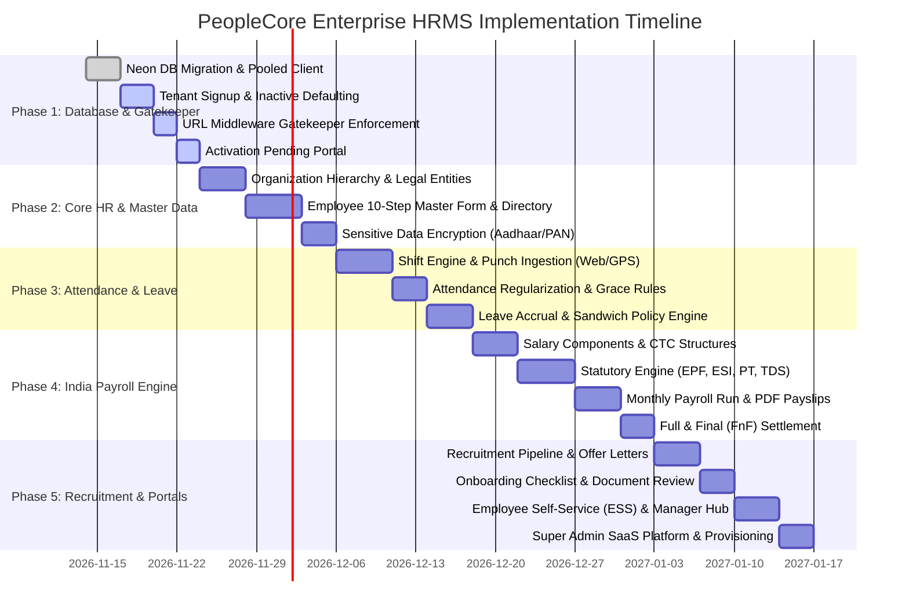

# HRMS Enterprise Implementation Roadmap & Module Coverage Tracker

**Document Reference:** HRMS-IMP-TRACK-2026  
**System Name:** PeopleCore Multi-Tenant HRMS SaaS  
**Target Database:** Neon PostgreSQL Serverless (`DATABASE_URL_POOLED`)  
**Status:** Architecture Complete • Specification Finalized • Implementation Ready

---

## 1. Multi-Phase Implementation Roadmap

---

## 2. Phase-by-Phase Technical Acceptance Criteria

### Phase 1: Neon Database Migration & Tenant Activation Gatekeeper (Days 1–10)
- **Dependencies:** Neon credentials (`DATABASE_URL`, `DATABASE_URL_POOLED`), Next.js Middleware.
- **Deliverables & Acceptance Criteria:**
  1. Neon PostgreSQL schema applied from `HRMS_DATABASE_AND_RELATIONSHIPS.md`.
  2. Implement `/signup` page capturing Organization Name, Admin Name, Email, Password, Mobile, City, Address.
  3. When tenant registers, verify in database: `status = 'inactive'`, `subscription_expiry_date = CURRENT_DATE - 1`.
  4. Next.js Middleware (`proxy.ts` / `middleware.ts`) strictly intercepts all `/dashboard`, `/employees`, `/payroll`, `/attendance`, `/leave`, etc. routes.
  5. If tenant is inactive or expired, immediately redirect to `/onboarding/activation-pending`.
  6. The `/onboarding/activation-pending` page renders tenant details, status, and instructions for Super Admin activation.
  7. Super Admin can toggle tenant `status = 'active'` and set a valid future expiry date from `/super-admin/companies`, unlocking full access to software pages.

### Phase 2: Core Organization & 360° Employee Lifecycle (Days 11–22)
- **Dependencies:** Phase 1 active session and tenant context.
- **Deliverables & Acceptance Criteria:**
  1. Company Profile, Branches, Departments, Designations, Job Grades, Cost Centres CRUD operational.
  2. 10-section Add Employee form (`/employees/new`) with full validation.
  3. 12-digit Aadhaar values encrypted via AES-256 before insertion into `employee_statutory_details`; only last 4 digits displayed.
  4. Employee directory with multi-select, filters, and export to Excel.
  5. 360° Employee Profile view with historical promotion and transfer timeline.

### Phase 3: Attendance, Shifts & Leave Engine (Days 23–34)
- **Dependencies:** Phase 2 employee records.
- **Deliverables & Acceptance Criteria:**
  1. Shift configuration supporting General, Rotational, and Cross-Midnight night shifts.
  2. Web check-in/out capturing geolocation, working hours calculation, grace periods, and late marks.
  3. Regularization workflow routing to reporting manager with mandatory reason.
  4. Leave balances ledger with monthly pro-rata accrual and carry-forward caps.
  5. Configurable Sandwich Leave rule correctly deducting intervening weekends/holidays.

### Phase 4: India Statutory Payroll & Full & Final Settlement (Days 35–50)
- **Dependencies:** Phase 3 attendance and LOP data.
- **Deliverables & Acceptance Criteria:**
  1. Salary structures with Basic, HRA, Special Allowance, PF, ESI, PT, and TDS.
  2. EPF calculation with ₹15,000 statutory wage ceiling and EPS/EPF split.
  3. ESIC calculation for gross wages $\le ₹21,000$.
  4. State-specific Professional Tax deduction for Karnataka, Maharashtra, Telangana, and Tamil Nadu.
  5. Section 192 TDS computation under New (Section 115BAC) and Old tax regimes.
  6. Monthly payroll run execution with variance audit, lock mechanism, PDF payslips, and NEFT bank batch file.
  7. Full and Final (FnF) calculation engine accounting for unpaid salary, leave encashment, gratuity, and notice pay recovery.

### Phase 5: Recruitment, Portals & Super Admin Platform (Days 51–65)
- **Dependencies:** Phases 1–4.
- **Deliverables & Acceptance Criteria:**
  1. Job opening requisitions, Kanban applicant tracking pipeline, interview scorecards, and offer letters.
  2. Onboarding checklist with document verification and IT asset handover.
  3. Mobile-responsive Employee Self-Service (ESS) portal (`/my/*`) and Manager Approval Hub (`/manager/*`).
  4. Super Admin SaaS management portal (`/super-admin/*`) with subscription analytics, tenant unfreeze controls, and billing logs.

---

## 3. Comprehensive Module & Submenu Coverage Checklist

| Module ID | Module Name | Page / Submenu Route | Functional Specification Status | Database DDL Ready | Business Rules Defined | Acceptance Criteria Met |
|---|---|---|---|---|---|---|
| **01** | Dashboard | Main & HR Overview (`/dashboard`) | Complete | Yes | Yes | Ready for DB Hookup |
| **01** | Dashboard | Employee & Attendance Widgets | Complete | Yes | Yes | Ready for DB Hookup |
| **01** | Dashboard | Pending Approvals Drawer | Complete | Yes | Yes | Ready for DB Hookup |
| **02** | Organization | Company Profile (`/organization/company`) | Complete | Yes | Yes | Ready for DB Hookup |
| **02** | Organization | Branches & Locations (`/organization/branches`) | Complete | Yes | Yes | Ready for DB Hookup |
| **02** | Organization | Departments (`/organization/departments`) | Complete | Yes | Yes | Ready for DB Hookup |
| **02** | Organization | Designations & Grades (`/organization/designations`) | Complete | Yes | Yes | Ready for DB Hookup |
| **02** | Organization | Cost Centres (`/organization/cost-centres`) | Complete | Yes | Yes | Ready for DB Hookup |
| **02** | Organization | Org Chart (`/organization/org-chart`) | Complete | Yes | Yes | Ready for DB Hookup |
| **03** | Employees | Directory (`/employees`) | Complete | Yes | Yes | Ready for DB Hookup |
| **03** | Employees | Add Employee Wizard (`/employees/new`) | Complete | Yes | Yes | Ready for DB Hookup |
| **03** | Employees | 360° Profile (`/employees/[id]`) | Complete | Yes | Yes | Ready for DB Hookup |
| **03** | Employees | Transfers & Promotions (`/employees/transfers`) | Complete | Yes | Yes | Ready for DB Hookup |
| **03** | Employees | Inactive Employees (`/employees/inactive`) | Complete | Yes | Yes | Ready for DB Hookup |
| **04** | Recruitment | Dashboard & Requisitions (`/recruitment`) | Complete | Yes | Yes | Ready for DB Hookup |
| **04** | Recruitment | Job Openings (`/recruitment/jobs`) | Complete | Yes | Yes | Ready for DB Hookup |
| **04** | Recruitment | Candidates & Pipeline (`/recruitment/candidates`) | Complete | Yes | Yes | Ready for DB Hookup |
| **04** | Recruitment | Interview Scheduling (`/recruitment/interviews`) | Complete | Yes | Yes | Ready for DB Hookup |
| **04** | Recruitment | Job Offers (`/recruitment/offers`) | Complete | Yes | Yes | Ready for DB Hookup |
| **05** | Onboarding | Dashboard & New Joiners (`/onboarding`) | Complete | Yes | Yes | Ready for DB Hookup |
| **05** | Onboarding | Checklists & IT Setup (`/onboarding/checklist`) | Complete | Yes | Yes | Ready for DB Hookup |
| **05** | Onboarding | Document Verification (`/onboarding/verification`)| Complete | Yes | Yes | Ready for DB Hookup |
| **06** | Attendance | Daily Attendance (`/attendance/daily`) | Complete | Yes | Yes | Ready for DB Hookup |
| **06** | Attendance | Attendance Register (`/attendance/register`) | Complete | Yes | Yes | Ready for DB Hookup |
| **06** | Attendance | Regularization Requests (`/attendance/regularization`)| Complete | Yes | Yes | Ready for DB Hookup |
| **06** | Attendance | Shift Management (`/attendance/shifts`) | Complete | Yes | Yes | Ready for DB Hookup |
| **06** | Attendance | Holidays Calendar (`/attendance/holidays`) | Complete | Yes | Yes | Ready for DB Hookup |
| **06** | Attendance | Overtime Tracking (`/attendance/overtime`) | Complete | Yes | Yes | Ready for DB Hookup |
| **07** | Leave | Leave Requests (`/leave/requests`) | Complete | Yes | Yes | Ready for DB Hookup |
| **07** | Leave | Leave Approvals (`/leave/approvals`) | Complete | Yes | Yes | Ready for DB Hookup |
| **07** | Leave | Leave Policies & Types (`/leave/policies`, `/types`)| Complete | Yes | Yes | Ready for DB Hookup |
| **07** | Leave | Leave Balances Ledger (`/leave/balances`) | Complete | Yes | Yes | Ready for DB Hookup |
| **07** | Leave | Team Leave Calendar (`/leave/calendar`) | Complete | Yes | Yes | Ready for DB Hookup |
| **08** | Payroll | Dashboard & Groups (`/payroll`, `/groups`) | Complete | Yes | Yes | Ready for DB Hookup |
| **08** | Payroll | Salary Components & Structures (`/components`) | Complete | Yes | Yes | Ready for DB Hookup |
| **08** | Payroll | Monthly Processing Run (`/payroll/process`) | Complete | Yes | Yes | Ready for DB Hookup |
| **08** | Payroll | Payslips Portal (`/payroll/payslips`) | Complete | Yes | Yes | Ready for DB Hookup |
| **08** | Payroll | Loans & Advances (`/payroll/loans`) | Complete | Yes | Yes | Ready for DB Hookup |
| **08** | Payroll | Tax Declarations & TDS (`/payroll/tax`) | Complete | Yes | Yes | Ready for DB Hookup |
| **09** | Timesheets | My Timesheets & Entry (`/timesheets/my`) | Complete | Yes | Yes | Ready for DB Hookup |
| **09** | Timesheets | Approvals & Billable Hours (`/timesheets/approvals`)| Complete | Yes | Yes | Ready for DB Hookup |
| **10** | Performance | Cycles & Goal Management (`/performance/goals`) | Complete | Yes | Yes | Ready for DB Hookup |
| **10** | Performance | Reviews & 360 Feedback (`/performance/reviews`) | Complete | Yes | Yes | Ready for DB Hookup |
| **11** | Training | Programs & Enrolments (`/training/programs`) | Complete | Yes | Yes | Ready for DB Hookup |
| **11** | Training | Certifications & History (`/training/certificates`)| Complete | Yes | Yes | Ready for DB Hookup |
| **12** | Expenses | My Claims & Approvals (`/expenses`, `/approvals`) | Complete | Yes | Yes | Ready for DB Hookup |
| **12** | Expenses | Categories & Limits (`/expenses/categories`) | Complete | Yes | Yes | Ready for DB Hookup |
| **13** | Assets | Asset Register & Inventory (`/assets/register`) | Complete | Yes | Yes | Ready for DB Hookup |
| **13** | Assets | Asset Assignments & Returns (`/assets/assignments`)| Complete | Yes | Yes | Ready for DB Hookup |
| **14** | Separation | Resignations & Clearances (`/separation`) | Complete | Yes | Yes | Ready for DB Hookup |
| **14** | Separation | Full & Final (FnF) Settlement (`/separation/fnf`) | Complete | Yes | Yes | Ready for DB Hookup |
| **15** | ESS Portal | My Dashboard, Attendance, Leaves (`/my/*`) | Complete | Yes | Yes | Ready for DB Hookup |
| **15** | ESS Portal | My Payslips, Documents, Helpdesk (`/my/*`) | Complete | Yes | Yes | Ready for DB Hookup |
| **16** | Manager | Team Attendance & Approvals (`/manager/*`) | Complete | Yes | Yes | Ready for DB Hookup |
| **17** | Approvals | Universal Engine & Builder (`/approvals/*`) | Complete | Yes | Yes | Ready for DB Hookup |
| **18** | Communication | Announcements & Events (`/communication/*`) | Complete | Yes | Yes | Ready for DB Hookup |
| **19** | Documents | Company Repository & Templates (`/documents/*`) | Complete | Yes | Yes | Ready for DB Hookup |
| **20** | Reports | Statutory & Management Reports (`/reports/*`) | Complete | Yes | Yes | Ready for DB Hookup |
| **21** | Admin / Roles | User Management, RBAC & Audit (`/admin/*`) | Complete | Yes | Yes | Ready for DB Hookup |
| **22** | Settings | Company, Statutory & ID Config (`/settings/*`) | Complete | Yes | Yes | Ready for DB Hookup |
| **23** | Super Admin | Tenant Onboarding Gate & Plans (`/super-admin/*`)| Complete | Yes | Yes | Ready for DB Hookup |

