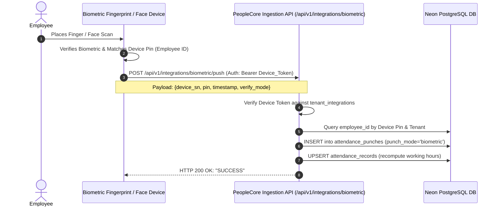

# HRMS Third-Party Integrations, Hardware Protocols & API Specifications

**Document Reference:** HRMS-INT-SPEC-2026  
**System Name:** PeopleCore Multi-Tenant HRMS SaaS  
**Security Standard:** Strict Server-Side Secret Management (Zero API tokens or encryption keys exposed in client bundles).

---

## 1. Hardware Biometric Attendance Integration (ZKTeco / eSSL / Realtime)

### 1.1 Architectural Pattern: Push Protocol (ADMS / Cloud Server)
Biometric terminals deployed across physical client offices stream punch events to PeopleCore via secure HTTP push webhooks.



### 1.2 Webhook Payload Specification
```json
{
  "device_serial": "ZKTECO-B2-9941",
  "punches": [
    {
      "enrollment_id": "EMP-0042",
      "timestamp": "2026-11-13T09:02:14+05:30",
      "punch_type": "in",
      "verification_type": "fingerprint"
    }
  ]
}
```

---

## 2. GPS & Mobile Geofencing Attendance API

### 2.1 Haversine Distance Geofencing Formula
When an employee punches from the mobile browser / PWA, the client requests device GPS coordinates (`latitude`, `longitude`, `accuracy`). The server verifies the punch against the assigned branch office location:

$$d = 2r \arcsin \left( \sqrt{\sin^2\left(\frac{\Delta \phi}{2}\right) + \cos(\phi_1)\cos(\phi_2)\sin^2\left(\frac{\Delta \lambda}{2}\right)} \right)$$

- Where $r = 6371000 \text{ meters}$ (Earth radius).
- If calculated distance $d \le \text{Permissible Radius } (R_{\text{branch}} = 100 \text{ meters})$: Punch accepted as `Present`.
- If $d > R_{\text{branch}}$: Punch rejected with message *"You are outside the permitted office geofence (" + round(d) + " meters away)"* unless "Work From Home" mode is approved.

---

## 3. Communication & Notification Gateways

### 3.1 WhatsApp Business Cloud API (Meta)
- **Use Cases:** Urgent leave approval prompts for managers, daily attendance punch summary, monthly payslip delivery link.
- **Provider:** Meta Graph API v21.0 / Gupshup / Twilio WhatsApp.
- **Authentication:** Permanent System User Access Token stored in encrypted tenant settings.
- **Template Example (Leave Approval):**
  > *"Hi Rajesh, Priya Sharma has requested 2 days of Casual Leave (18 Nov - 19 Nov). Reason: Family wedding. Click to Approve: https://app.peoplecore.io/approvals/req-991?action=approve"*

### 3.2 Transactional Email (Resend / AWS SES)
- **DKIM & SPF Enforced:** Uses tenant-specific subdomains or system default (`notifications@peoplecore.io`).
- **Templates:** Welcome email with temporary credentials, password resets, offer letter delivery, monthly PDF payslip attachments.

---

## 4. Banking & Salary Disbursal Integrations

### 4.1 Direct Corporate Banking APIs (ICICI CIB / HDFC E-CMS)
- **Supported Integrations:**
  1. *Direct API Integration:* Mutual TLS (mTLS) with public key cryptography for real-time NEFT/RTGS disbursal.
  2. *Encrypted Batch File Disbursal:* Generates 128-bit AES encrypted Excel/Text files matching bank standard format (HDFC E-CMS, ICICI I-Core, Kotak Mahindra Direct Payouts).

### 4.2 ICICI Corporate Banking File Structure
- Columns: `Debit Account No`, `Beneficiary Name`, `Beneficiary Account No`, `IFSC Code`, `Amount`, `Remarks (Month Payroll)`.

---

## 5. Accounting & ERP Integrations (Tally Prime / Zoho Books / QuickBooks)

### 5.1 Automated Payroll Journal Entry
Upon payroll finalization, the system posts an automated double-entry accounting journal:

| Account Name | Debit (₹) | Credit (₹) | Notes |
|---|---|---|---|
| **Salaries & Wages Expense** | ₹25,00,000 | - | Total Monthly Gross CTC |
| **Employer EPF Contribution Expense** | ₹1,50,000 | - | Employer PF + Admin |
| **Employer ESIC Expense** | ₹45,000 | - | Employer ESIC (3.25%) |
| **EPF Payable Account** | - | ₹3,00,000 | EE Share + ER Share |
| **ESIC Payable Account** | - | ₹55,000 | EE Share + ER Share |
| **Professional Tax Payable** | - | ₹25,000 | Deducted PT |
| **TDS Section 192 Payable** | - | ₹1,20,000 | Deducted Income Tax |
| **Salaries Net Disbursal Clearing Account** | - | ₹21,95,000 | Net Bank Disbursal Due |

- **Export Formats:** Tally XML (`<ENVELOPE><BODY><DATA><TALLYMESSAGE>...</TALLYMESSAGE></DATA></BODY></ENVELOPE>`), Zoho Books API JSON payload.

---

## 6. Background Verification & Identity APIs (DigiLocker / Karza)

- **Aadhaar Verification:** Instant verification via OTP sent to the employee's UIDAI-linked mobile phone via authorized AUA/KUA gateway.
- **PAN Verification:** Validates PAN number, name matching score, and Active/Inoperative status against the Income Tax Department database.
- **Bank Account Penny Drop:** Deposits ₹1.00 into candidate's bank account to verify active status and exact beneficiary name matching prior to first salary run.

