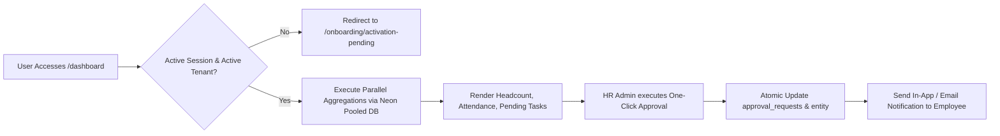
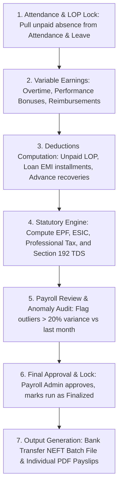

# HRMS Page-by-Page Feature Analysis & Functional Requirements Specification

**Document Reference:** HRMS-FRS-PBP-2026  
**System Name:** PeopleCore Enterprise Multi-Tenant HRMS SaaS  
**Standard Architecture:** Next.js 16 App Router, TypeScript, Tailwind CSS, Neon PostgreSQL  
**Multi-Tenant Gateway:** All internal routes are guarded by Tenant Status (`active`) & Expiry Date (`>= CURRENT_DATE`). Unactivated or expired tenants are gated to `/onboarding/activation-pending`.

---

# MODULE 1: Dashboard

## 1.1 Main Dashboard & HR Overview (`/dashboard`)

### A. Page Overview
- **Page Name:** Executive HR & Operational Dashboard
- **Module Name:** Dashboard (Module 01)
- **Menu Location:** Sidebar > Dashboard > HR Overview (`/dashboard`)
- **Purpose:** Central command center providing real-time visibility into workforce headcount, daily attendance health, leave liabilities, open recruitment requisitions, payroll readiness, and pending operational approvals.
- **Business Problem Solved:** Eliminates fragmented reporting by consolidating real-time organizational KPIs into a single actionable surface with one-click drill-downs.
- **Primary Users:** HR Administrator, HR Manager, Company Admin, Executive Leadership.
- **Allowed Roles:** `super_admin`, `company_owner`, `company_admin`, `hr_admin`, `hr_manager`.
- **Related Pages:** `/employees`, `/attendance/daily`, `/leave/approvals`, `/payroll/process`, `/recruitment/jobs`.

### B. Page Layout
- **Page Heading:** "Executive HR Dashboard" with dynamic current date and live tenant organization name.
- **Breadcrumbs:** `Home > Dashboard > Overview`
- **Summary Cards (4-Column Top Deck):**
  1. *Total Headcount:* Total active employees, net change (+/-) this month, gender diversity ratio.
  2. *Today's Attendance:* Present count and percentage, Absent, On Leave, Late arrivals.
  3. *Pending Approvals:* Total pending actions across leaves, regularizations, expenses, and resignations.
  4. *Monthly Payroll CTC:* Current month estimated gross payroll disbursement and payment status.
- **Action Buttons / Bar:** Date selector (Today / This Week / This Month / Custom), Branch/Department filter dropdown, "Quick Punch", "+ Quick Actions" dropdown.
- **Interactive Widgets & Charts:**
  - *Attendance Trend (7 Days):* Stacked bar chart showing Present, Absent, Half-Day, and Leave.
  - *Headcount by Department:* Donut chart displaying workforce distribution with legend.
  - *Recruitment Funnel:* Pipeline progress (Applied -> Screening -> Interview -> Offer -> Hired).
  - *Leave Utilization:* Gauge chart showing annual leave quota consumed across departments.
- **Lists / Quick Panels:**
  - *Birthday & Work Anniversary Widget:* Carousel of celebrations today and upcoming 7 days with "Send Wishes" action.
  - *Pending Action Drawer:* Tabbed listing of urgent approval items with instant "Approve" / "Reject" buttons.
  - *Recent Announcements Banner:* Pinned company announcements with read acknowledgments.
- **Responsive Mobile Layout:** Collapses 4 KPI cards to single-column swipeable cards; charts become full-width touch-interactive cards; quick actions float in a bottom action sheet.

### C. Every Field Required

| Field | Data Type | Required | Validation | Default Value | Description |
|---|---|---|---|---|---|
| `selected_branch_id` | UUID | No | Valid branch belonging to current tenant | `all` | Filter all dashboard widgets by specific company branch |
| `selected_department_id` | UUID | No | Valid department belonging to tenant | `all` | Filter metrics by functional department |
| `date_range` | Date Range | Yes | Valid date interval within last 365 days | `current_month` | Time boundary for attendance and trend computations |
| `quick_note_content` | String (Text) | No | Max 500 characters | Empty | Personal scratchpad notes for HR admins |

- **Dropdown Options:**
  - *Branch Filter:* All Branches, Headquarters, Bangalore Tech Centre, Mumbai Sales Hub, Delhi Operations.
  - *Department Filter:* All Departments, Engineering, Product & Design, Sales, Marketing, People Operations, Finance.
  - *Date Range Filter:* Today, Yesterday, Last 7 Days, Current Month, Previous Month, Custom Range.
- **Role Visibility:** CTC values and financial figures are strictly hidden from users lacking `hr_admin` or `payroll_admin` roles.

### D. Buttons and Actions
1. **Filter Apply Button:**
   - *Purpose:* Re-queries database with branch, department, and date filters.
   - *Allowed Roles:* All dashboard viewers.
   - *Execution:* Client triggers server action `getDashboardMetricsAction(filters)`. No modal required.
2. **One-Click Quick Approve (on Pending Approvals widget):**
   - *Purpose:* Approves urgent leave or expense without leaving dashboard.
   - *Confirmation:* Toast prompt with "Undo" window (5 seconds).
   - *Database Operation:* Updates `approval_requests.status = 'approved'`, logs `approval_actions`.
   - *Notifications:* Dispatches in-app and email notification to requesting employee.
3. **Export Dashboard Summary:**
   - *Purpose:* Generates executive PDF snapshot of workforce metrics.
   - *Execution:* Triggers server-side PDF generation pipeline.

### E. Tables and Listing Requirements (Pending Actions Widget)
- **Columns:** Requester Name & Avatar, Request Type (Leave / Regularization / Expense / Resignation), Submission Date, Details (e.g., "Casual Leave: 2 Days", "Travel Expense: ₹4,500"), Priority Badge, Actions.
- **Sorting:** Submission Date (Default: Descending).
- **Pagination:** 5 items visible with "View All (Count)" link navigating to `/approvals/pending`.
- **Row-Level Actions:** "Approve" (Green check icon), "Reject" (Red cross icon with mandatory reason modal), "View Details".

### F. Business Logic
- **Headcount Calculation:** Count of `employees` where `tenant_id = current_tenant` AND `employment_status = 'active'` AND `joining_date <= CURRENT_DATE`.
- **Today's Attendance Rate:** `(Present Employees / Total Scheduled Employees) * 100`, excluding employees on approved weekly offs or public holidays.
- **Tenant Validation:** Must enforce that tenant subscription status is `active` and expiry date is strictly in the future.

### G. Workflow

### H. Database Requirements
- **Tables Consulted:** `tenants`, `employees`, `attendance_records`, `leave_applications`, `approval_requests`, `payroll_runs`, `announcements`.
- **Tenant Isolation:** Enforced via `tenant_id = current_setting('app.current_tenant_id')`.
- **Indexes Utilized:** `idx_employees_tenant_status`, `idx_attendance_tenant_date`, `idx_approval_requests_status`.

### I. Permissions
- `View General Metrics`: Company Admin, HR Admin, HR Manager.
- `View Payroll Financials`: HR Admin, Payroll Admin only.
- `Execute Approvals`: Authorized Manager or HR Admin.

### J. Notifications
- Real-time badge counter incremented via WebSocket or polling when new approval requests are filed.

### K. Reports and Analytics
- Feeds high-level KPI benchmarks into executive Monthly Workforce Scorecards.

### L. Validation and Error Handling
- Handles transient network disconnection with graceful retry back-off.
- Displays empty state illustrations when no pending approvals exist.

### M. Additional Recommendations
- Integrate AI-driven anomaly highlights (e.g., "Engineering department has 28% higher unscheduled absenteeism today compared to 30-day average").

---

# MODULE 2: Organization Management

## 2.1 Company Profile (`/organization/company`)

### A. Page Overview
- **Page Name:** Enterprise Company Profile & Legal Entities
- **Module Name:** Organization Management (Module 02)
- **Menu Location:** Sidebar > Organization > Company Profile (`/organization/company`)
- **Purpose:** Configures company identity, legal registrations (PAN, GSTIN, CIN), statutory addresses, fiscal year definitions, base operating currency, and timezones.
- **Business Problem Solved:** Provides canonical organizational metadata consumed across payroll slips, statutory tax filings, letter templates, and branch structures.
- **Allowed Roles:** `super_admin`, `company_owner`, `company_admin`, `hr_admin`.

### B. Page Layout
- **Page Heading:** "Company Profile & Legal Registrations"
- **Breadcrumbs:** `Organization > Company Profile`
- **Tabs:**
  1. *General Information:* Trade name, legal entity name, corporate logo, industry, website.
  2. *Legal & Statutory:* Corporate Identification Number (CIN), Permanent Account Number (PAN), GSTIN, TAN, EPF Establishment Code, ESIC Code.
  3. *Registered Address:* Full postal address, pincode, state, city, country.
  4. *Preferences & Fiscal Policy:* Financial year start month, default currency (INR), system timezone (`Asia/Kolkata`).
- **Action Buttons:** "Save Changes", "Discard", "Download Organization Summary".

### C. Every Field Required

| Field | Data Type | Required | Validation | Default Value | Description |
|---|---|---|---|---|---|
| `legal_name` | String (Text) | Yes | 3 - 150 chars | Empty | Official registered entity name as per MCA documents |
| `trade_name` | String (Text) | Yes | 3 - 100 chars | Empty | Publicly known operating brand name |
| `cin_number` | String | No | Regex `^[LU][0-9]{5}[A-Z]{2}[0-9]{4}[A-Z]{3}[0-9]{6}$` | Empty | Corporate Identification Number (21 alphanumeric characters) |
| `pan_number` | String | Yes | Regex `^[A-Z]{5}[0-9]{4}[A-Z]{1}$` | Empty | 10-digit Permanent Account Number of the entity |
| `gstin` | String | No | Regex `^[0-9]{2}[A-Z]{5}[0-9]{4}[A-Z]{1}[1-9A-Z]{1}Z[0-9A-Z]{1}$` | Empty | 15-digit Goods and Services Tax Identification Number |
| `epf_establishment_code` | String | No | Standard EPFO alphanumeric format | Empty | 15-digit EPFO establishment code for statutory returns |
| `esic_code` | String | No | 17-digit numeric code | Empty | ESIC regional employer registration code |
| `email` | Email | Yes | Valid RFC email | Empty | Official corporate contact email |
| `phone` | String | Yes | Indian format 10 digits | Empty | Official telephone / contact number |
| `address_line1` | String | Yes | 5 - 255 chars | Empty | Building, street name, and door number |
| `city` | String | Yes | 2 - 50 chars | Empty | City of registered office |
| `state` | String | Yes | Valid Indian State list | Empty | State code (consumed for Professional Tax state mapping) |
| `pincode` | String | Yes | 6-digit numeric | Empty | Indian postal code |
| `financial_year_start` | Integer | Yes | Value between 1 and 12 | 4 (April) | Month starting the financial year (4 = April for India) |
| `currency` | String | Yes | 3-letter ISO (INR, USD) | `INR` | Default accounting currency |
| `timezone` | String | Yes | Valid IANA timezone | `Asia/Kolkata` | Base operating timezone |

### D. Buttons and Actions
- **Save Profile Button:** Validates fields, issues `UPDATE companies SET ... WHERE tenant_id = current_tenant`, commits audit log, shows success toast.
- **Upload Brand Logo:** Accepts PNG/JPEG up to 2MB, crops to square, uploads to secure storage bucket, updates `logo_url`.

### E. Business Logic
- PAN and GSTIN checksums must validate against official Indian tax authority patterns.
- Changing `financial_year_start` or `currency` requires a confirmation modal warning that historical payroll calculations remain bound to previous snapshots.

---

## 2.2 Branches & Work Locations (`/organization/branches`)

### A. Page Overview
- **Purpose:** Manages multi-branch physical locations, regional offices, and factories.
- **Key Business Rule:** Each branch is mapped to a specific Indian State to govern Professional Tax (PT) deduction rules, regional public holidays, and state Shop & Establishment Act compliance.
- **Allowed Roles:** `company_admin`, `hr_admin`.

### B. Table & Field Specifications
- **Table Columns:** Branch Code, Branch Name, State/UT, City, Branch Head (Employee link), Total Employees, Status (`Active` / `Inactive`), Actions.
- **Create Branch Modal Fields:** `Branch Name` (Required), `Branch Code` (Unique within tenant), `State` (Dropdown: 28 States & 8 UTs), `City`, `Address`, `Branch Head ID` (Select from active employees), `Is Headquarters` (Boolean toggle).

---

## 2.3 Departments & Subdepartments (`/organization/departments`)

### A. Page Overview
- **Purpose:** Hierarchical department tree (e.g., Engineering -> Frontend -> UI Team).
- **Key Business Rule:** Departments can have parent-child hierarchies. Department Head (`head_id`) receives escalated approvals for leaves and performance cycles.
- **Fields:** `Department Name` (Required), `Department Code` (Required, unique), `Parent Department` (Optional self-reference), `Department Head` (Select employee), `Cost Centre Allocation`, `Status`.

---

## 2.4 Designations & Job Grades (`/organization/designations`, `/organization/job-grades`)

### A. Page Overview
- **Designations:** Role titles (e.g., Senior Full Stack Engineer, VP of Product). Mapped to Departments.
- **Job Grades:** Compensation bands (e.g., Band E1: ₹4,00,000 - ₹7,00,000 CTC; Band E5: ₹25,00,000 - ₹40,00,000 CTC). Enforces salary band compliance during recruitment offers and promotions.

---

## 2.5 Organizational Chart (`/organization/org-chart`)

### A. Page Overview
- **Purpose:** Interactive visual tree visualizing company reporting hierarchy from CEO/Managing Director down to individual contributors.
- **UI Architecture:** SVG / Canvas hierarchical node rendering with zoom, pan, department filtering, and employee card modals with direct profile links.

---

# MODULE 3: Employee Management

## 3.1 Employee Directory (`/employees`)

### A. Page Overview
- **Purpose:** Enterprise employee master list supporting advanced multi-criteria search, filters, pagination, bulk operations, and full lifecycle statuses.
- **Allowed Roles:** All authenticated roles (with role-restricted field visibility).

### B. Table & Search Specifications
- **Columns:** Employee ID & Photo, Full Name, Work Email, Branch, Department, Designation, Reporting Manager, Joining Date, Employment Status (`Active`, `Probation`, `Notice Period`, `Terminated`, `On Leave`), Actions.
- **Filters:** Branch, Department, Designation, Employment Type (Full-Time, Contract, Intern), Status, Joining Date Range.
- **Bulk Actions:** Bulk Export to Excel, Bulk Send Announcement, Bulk Assign Shift, Bulk Status Change.

---

## 3.2 Add Employee Master Form (`/employees/new`)

### A. Comprehensive Form Specification (10-Section Wizard)

#### Section 1: Basic & Personal Details
| Field | Type | Required | Validation | Description |
|---|---|---|---|---|
| `employee_id` | String | Yes | Unique per tenant, auto-generated or manual | E.g. `PC-2026-0042` |
| `first_name` | String | Yes | 2-50 chars, Alphabetic | Employee legal first name |
| `middle_name` | String | No | Alphabetic | Optional middle name |
| `last_name` | String | Yes | 1-50 chars, Alphabetic | Employee legal surname |
| `date_of_birth` | Date | Yes | Age must be >= 18 years | Verification against statutory child labor laws |
| `gender` | Dropdown | Yes | Male, Female, Other, Prefer Not to Say | Used for diversity reporting & POSH |
| `marital_status` | Dropdown | Yes | Single, Married, Divorced, Widowed | Required for insurance & gratuity nominations |
| `blood_group` | Dropdown | No | A+, A-, B+, B-, AB+, AB-, O+, O- | Emergency medical profile |
| `nationality` | String | Yes | Default: `Indian` | Work visa compliance for foreign nationals |

#### Section 2: Contact Information
| Field | Type | Required | Validation | Description |
|---|---|---|---|---|
| `personal_email` | Email | Yes | Valid email format | Onboarding invitations & recovery |
| `work_email` | Email | Yes | Valid corporate domain email | System SSO & internal communications |
| `mobile_phone` | String | Yes | 10 digits Indian mobile | Primary SMS/WhatsApp contact |
| `alternate_phone`| String | No | 10 digits | Secondary emergency contact |
| `current_address`| JSONB | Yes | Door, Street, City, State, Pincode | Physical place of current residence |
| `permanent_address`| JSONB| Yes | Same as current toggle available | Permanent domicile address |

#### Section 3: Employment & Position Details
| Field | Type | Required | Validation | Description |
|---|---|---|---|---|
| `joining_date` | Date | Yes | Standard calendar date | Official start date for payroll & gratuity |
| `employment_type`| Dropdown| Yes | Full-Time, Part-Time, Contract, Intern | Defines statutory benefits eligibility |
| `branch_id` | UUID | Yes | Active branch of tenant | Determines PT slab & holiday calendar |
| `department_id`| UUID | Yes | Active department | Organizational alignment |
| `designation_id`| UUID | Yes | Active designation | Role title |
| `job_grade_id` | UUID | No | Active job grade | Compensation band validation |
| `reporting_manager_id`| UUID | No | Active employee | Direct supervisor for approval routing |
| `probation_period_months`| Integer | No | 0 to 12 months | Probationary review tracking |
| `notice_period_days`| Integer | Yes | 15, 30, 60, 90 days | Contractual exit requirement |

#### Section 4: Bank Details (Sensitive)
| Field | Type | Required | Validation | Description |
|---|---|---|---|---|
| `bank_name` | String | Yes | 2-100 chars | Bank name (e.g., HDFC Bank, ICICI Bank) |
| `account_holder_name`| String | Yes | Matches PAN/Aadhaar name | Bank account title |
| `account_number`| String | Yes | 9-18 digits | Salary crediting account |
| `ifsc_code` | String | Yes | Regex `^[A-Z]{4}0[A-Z0-9]{6}$` | Valid RBI IFSC branch code |
| `account_type` | Dropdown | Yes | Savings, Current | Default: Savings |

#### Section 5: India Statutory & Tax Details (Strictly Guarded)
| Field | Type | Required | Validation | Description |
|---|---|---|---|---|
| `pan_number` | String | Yes | Regex `^[A-Z]{5}[0-9]{4}[A-Z]{1}$` | Mandatory for TDS Section 192 compliance |
| `aadhaar_number`| String | Yes | 12-digit numeric (Verhoeff check) | Encrypted storage; only last 4 digits displayed |
| `uan_number` | String | No | 12-digit numeric | Universal Account Number for EPFO |
| `pf_member_id` | String | No | EPFO regional member ID | If previously enrolled in EPF |
| `esi_number` | String | No | 17-digit numeric | Mandatory if Gross wage <= ₹21,000 |
| `tax_regime` | Dropdown | Yes | `new` (Section 115BAC) or `old` | Determines TDS calculation slabs |

#### Section 6: Education & Prior Experience
- Allows adding multiple educational qualifications (Degree, University, Passing Year, Grade, Certificate URL).
- Allows adding multiple prior employment records (Company, Designation, Start Date, End Date, Last Drawn CTC, Relieving Letter).

#### Section 7: Documents & Login Provisioning
- Document uploads: Photo, PAN Card copy, Aadhaar copy, Cancelled Cheque, Educational Certificates.
- **Login Account Provisioning:** Checkbox "Create Login Account", with initial system role (`employee`, `manager`, `hr_admin`) and auto-generated temporary password dispatched via welcome email.

---

## 3.3 Employee 360° Profile View (`/employees/[id]`)
- **Header:** Employee banner with avatar, full name, employee ID, designation, department, branch, status badge, and contact action buttons.
- **Sub-Tabs:**
  1. *Overview:* Quick stats, reporting line, upcoming leaves, current asset allocations.
  2. *Personal & Family:* Demographics, emergency contacts, dependents.
  3. *Job & Timeline:* Historical career promotions, transfers, designation changes.
  4. *Salary & Compensation:* Current CTC breakdown, monthly salary structure, increment history.
  5. *Attendance & Leaves:* Current month attendance calendar, leave balance ledger.
  6. *Statutory & Compliance:* Masked PAN/Aadhaar, UAN, PF number, tax regime.
  7. *Documents Dossier:* Uploaded and verified identity/employment documents.
  8. *Performance & Goals:* Current cycle OKRs and historical appraisal ratings.

---

# MODULE 4: Recruitment Management

## 4.1 Recruitment Dashboard & Job Requisitions (`/recruitment`, `/recruitment/jobs`)

### A. Core Features & Lifecycle
- **Job Requisitions:** Hiring managers submit head-count requisitions specifying: Title, Department, Vacancies, Budgeted CTC Range, Justification, and Job Description.
- **Job Postings:** Published internal job board and external shareable public link with custom application form.
- **Candidate Database & Pipeline (`/recruitment/candidates`, `/recruitment/applications`):**
  - Interactive Kanban Board with stages: `Applied` -> `Screening` -> `Interview Round 1` -> `Interview Round 2` -> `HR Discussion` -> `Offer Extended` -> `Hired` -> `Rejected`.
  - Candidate Profile: Resume viewer, experience summary, interview evaluation scorecard ratings (1 to 5 stars), and interview notes.
- **Interview Scheduling (`/recruitment/interviews`):** Calendar invite integration (Google Meet / Microsoft Teams / In-Person), interviewer panel assignment, and structured feedback rubric.
- **Job Offer Generation (`/recruitment/offers`):** Automated offer letter generation pulling dynamic salary structures, sign-off workflow, offer expiry tracking, and candidate digital acceptance.

---

# MODULE 5: Onboarding Management

## 5.1 Onboarding Lifecycle (`/onboarding`)

### A. Core Workflow & Pages
1. **Pre-Boarding Portal:** Hired candidate receives secure link to upload documents (PAN, Aadhaar, degree certificates, previous company relieving letters) prior to day one.
2. **Onboarding Checklist (`/onboarding/checklist`):**
   - *HR Induction:* Company handbook acknowledgment, code of conduct, POSH training.
   - *IT Provisioning:* Corporate email account creation, VPN access, hardware laptop allocation.
   - *Finance & Admin:* Bank account verification, statutory PF/ESI forms (Form 11), ID card issuance.
3. **Document Verification (`/onboarding/verification`):** HR checklist to verify uploaded certificates against originals with `Verified` or `Rejection with Comments` flags.
4. **Onboarding Completion:** Automatically shifts employee status from `Pre-boarding` to `Active` on their joining date and activates their ESS login.

---

# MODULE 6: Attendance Management

## 6.1 Daily Attendance & Check-In/Out (`/attendance/daily`, `/attendance`)

### A. Punch Capture & Geo-Fencing
- **Punch Modes Supported:**
  1. *Web Clock-In:* IP-address verified web punch from browser.
  2. *Mobile GPS Attendance:* Latitude/Longitude geo-fenced against configured branch coordinates with permissible radius (e.g., 100 meters).
  3. *Biometric Device Sync:* Automated punch ingestion from biometric fingerprint / facial terminals via REST API webhook.
- **Calculations & Rules:**
  - *Working Hours:* Cumulative duration between First Check-In and Last Check-Out minus unpaid break durations.
  - *Grace Period:* Configurable (e.g., 15 minutes). If shift begins at 09:00 AM, punches up to 09:15 AM are marked `Present`. Punches between 09:16 AM and 10:30 AM are marked `Late Arrival`.
  - *Half-Day Cut-off:* Working between 4.0 and 8.0 hours on an 8-hour shift marks `Half-Day`. Working < 4.0 hours marks `Absent`.

---

## 6.2 Attendance Regularization (`/attendance/regularization`)
- **Use Case:** Employee forgot to punch or attended client site.
- **Workflow:** Employee submits date, correct check-in/out times, and mandatory reason.
- **Routing:** Direct manager reviews and approves -> Updates `attendance_records` status to `regularized` with audit tag.

---

## 6.3 Shift Management & Night Shifts (`/attendance/shifts`)
- **Shift Configurations:** General Shift (09:00 - 18:00), Morning (06:00 - 14:30), Afternoon (14:00 - 22:30), Night Shift (22:00 - 06:30 next day).
- **Cross-Midnight Boundary Rule:** For shifts crossing midnight, the attendance record is pegged to the shift's starting calendar date.

---

# MODULE 7: Leave Management

## 7.1 Leave Types, Policies & Balances (`/leave`)

### A. Leave Types Supported
1. **Casual Leave (CL):** Short-term personal leaves, max 2 consecutive days.
2. **Earned / Privilege Leave (EL/PL):** Accrues at 1.25 or 1.5 days per month worked. Eligible for year-end carry-forward and encashment.
3. **Sick / Medical Leave (SL):** Requires medical practitioner certificate if > 2 consecutive days.
4. **Maternity Leave (ML):** 26 weeks paid leave as per Indian Maternity Benefit (Amendment) Act.
5. **Paternity Leave (PL):** Configurable (typically 5 to 15 working days).
6. **Compensatory Off (Comp-Off):** Credited when employee works on designated weekly off or public holiday.
7. **Loss of Pay (LOP):** Unpaid leave directly deducted from payroll monthly paid days.

### B. Business Rules & Sandwich Leave Rule
- **Sandwich Rule Toggle:** If enabled in settings, when an employee takes leave on Friday AND Monday, the intervening Saturday and Sunday are counted and deducted as leave days.
- **Negative Balance Restriction:** Configurable setting prevents submission if available balance is zero.

---

# MODULE 8: Payroll Management & India Statutory Compliance

## 8.1 Salary Components & CTC Structuring (`/payroll/components`, `/payroll/structures`)

### A. Standard India Salary Stack
1. **Basic Salary:** Typically 40% - 50% of monthly CTC. Serves as base for EPF and Gratuity.
2. **House Rent Allowance (HRA):** 50% of Basic for Metro cities (Delhi, Mumbai, Kolkata, Chennai); 40% of Basic for non-metro cities.
3. **Statutory Bonus / Advance Statutory Bonus:** Under Payment of Bonus Act (min 8.33% of Basic/₹7,000).
4. **Special Allowance / Flexible Benefit Plan:** Balancing figure to reconcile Gross with CTC.
5. **Employer EPF Contribution:** 12% of Basic (capped at ₹1,800/month if opt-out applied or computed on actual Basic).
6. **Employer ESIC Contribution:** 3.25% of Gross wages (if Gross <= ₹21,000).
7. **Gratuity Provision:** 4.81% of Basic salary.

---

## 8.2 Monthly Payroll Processing Run (`/payroll/process`)

### A. Step-by-Step Processing Pipeline

### B. India Statutory Deductions Formulas
1. **Employee Provident Fund (EPF):**
   - Employee Contribution: 12% of `MIN(Basic Salary, ₹15,000)` (or full Basic if company policy dictates).
   - Employer Contribution: 12% split as:
     - 8.33% to Employee Pension Scheme (EPS), capped at ₹1,250/month.
     - 3.67% to Employee Provident Fund (EPF).
     - 0.50% EDLI (Deposit Linked Insurance) + 0.50% EPF Admin Charges.
2. **Employee State Insurance (ESIC):**
   - Applicable if Gross Wage <= ₹21,000/month.
   - Employee deduction: 0.75% of Gross Wage.
   - Employer contribution: 3.25% of Gross Wage.
3. **Professional Tax (PT):**
   - State-specific monthly slab deductions (e.g., Maharashtra: ₹200/month except February ₹300; Karnataka: ₹200/month for gross > ₹15,000; Telangana: ₹200/month for gross > ₹20,000).
4. **TDS (Income Tax Section 192):**
   - Calculated each month based on employee's chosen regime (`New Tax Regime Section 115BAC` vs `Old Tax Regime` with Section 80C, 80D, HRA declarations).

---

## 8.3 Payslips & Bank Transfer Files (`/payroll/payslips`)
- Generates tamper-proof PDF payslips accessible on ESS portal with company seal, detailed earnings, deductions, YTD earnings, PF UAN, ESIC number, and leave balance summary.
- Generates formatted Bank Disbursal Excel/CSV sheets for ICICI, HDFC, SBI, and Kotak Mahindra direct CMS uploads.

---

# MODULE 9: Timesheet & Project Management

## 9.1 Timesheet Entry & Approvals (`/timesheets`)
- **Projects & Task Categories:** Client Projects, Internal Products, R&D, Maintenance.
- **Weekly Timesheet Grid:** 7-day column grid (Monday to Sunday) where consultants log hours against Project + Task + Billable/Non-Billable status.
- **Validation:** Minimum 8 hours per working day required for full-time employees; flags weekly totals > 48 hours for overtime review.
- **Approval Flow:** Submitted weekly -> Project Manager approves billable hours -> Locks timesheet record against edits.

---

# MODULE 10: Performance Management

## 10.1 Appraisal Cycles, Goals & 360° Reviews (`/performance`)
- **Performance Cycles:** Annual, Bi-Annual, or Quarterly review cycles with defined phases (Goal Setting -> Mid-Year Check-in -> Self Evaluation -> Manager Review -> HR Normalization).
- **Goal Management (OKRs / KPIs):** SMART Goals with metric targets, weightages summing to 100%, and real-time progress sliders.
- **Review Form:** 5-point rating scale (1 - Unsatisfactory, 2 - Needs Improvement, 3 - Meets Expectations, 4 - Exceeds Expectations, 5 - Outstanding) with qualitative feedback fields.
- **Bell Curve Calibration:** HR normalization dashboard displaying rating distribution against standard bell curve recommendations.

---

# MODULE 11: Learning & Development

## 11.1 Training Programs & Certifications (`/training`)
- **Catalog:** Technical, Soft Skills, Leadership, and Mandatory Compliance courses (e.g., Annual POSH Compliance).
- **Session Scheduling:** Trainer assignment, venue/video link, enrollment capacity, and waitlists.
- **Assessments & Certificates:** Post-training quiz assessments; auto-generation of PDF Completion Certificates pinned to employee profile.

---

# MODULE 12: Expense Management

## 12.1 Expense Claims & Approvals (`/expenses`)
- **Categories:** Travel & Lodging, Client Entertainment, Meals & Per Diem, Office Supplies, Training & Books.
- **Claim Submission:** Date, Category, Currency, Amount, Tax amount, Project billing tag, Merchant name, Receipt upload (JPG/PNG/PDF).
- **Policy Enforcement:** Flags claims exceeding category per-transaction limits (e.g., Dinner max ₹1,200 without VP approval).
- **Payout:** Approved expenses batched into monthly payroll reimbursement or paid via direct voucher.

---

# MODULE 13: Asset Management

## 13.1 Asset Register & Lifecycle (`/assets`)
- **Asset Categories:** Laptops, Monitors, Mobile Devices, Peripherals, Software Licenses, Furniture.
- **Fields:** Asset Code, Serial Number, Brand, Model, Purchase Date, Warranty Expiry, Vendor, Purchase Cost.
- **Assignment & Return:** Digital asset handover agreement with serial number tracking; mandatory physical inspection and return sign-off during employee offboarding.

---

# MODULE 14: Separation & Exit Management

## 14.1 Resignations & Full & Final Settlement (`/separation`)
- **Resignation Workflow:** Employee submits resignation with last working day (LWD) request -> Reporting Manager review -> HR approval.
- **Notice Period Waiver:** Calculates notice shortfall days and corresponding salary recovery.
- **Department Clearances:** Multi-department digital sign-off:
  - *Reporting Manager:* Knowledge transfer (KT) completion.
  - *IT Department:* Laptop, access tokens, and email revocation.
  - *Finance / Accounts:* Loan clearing, expense advances settling.
  - *Admin:* ID card, access keycards.
- **Full & Final (FnF) Settlement Engine:**
  - Net Payable = Unpaid Days Salary + Accrued Leave Encashment + Gratuity (if tenure >= 5 yrs) + Bonus Due - Notice Pay Shortfall - Asset Dues - Tax Deductions.
- **Exit Documents:** Automated generation of formal Relieving Letter and Service Experience Certificate.

---

# MODULE 15: Employee Self-Service (ESS) Portal

## 15.1 Employee Self-Service Suite (`/my`)
- **My Dashboard (`/my/dashboard`):** Personalized view of remaining leaves, recent payslips, shift timetable, quick Punch-In/Out widget, and assigned training tasks.
- **My Profile (`/my/profile`):** View personal information; submit change requests for address, bank details, or emergency contacts (routed to HR for verification).
- **My Attendance & Regularization (`/my/attendance`, `/my/checkin`):** Interactive personal monthly attendance calendar with one-click "Apply Regularization" for missed punches.
- **My Leaves (`/my/leave`):** Check live balance by leave type, apply for leave with leave balance forecast, view historical requests.
- **My Payslips & Tax (`/my/payslips`):** Download monthly PDF payslips, submit annual Section 80C/80D/HRA rent receipt tax declarations.
- **HR Helpdesk (`/my/help`):** Raise internal support tickets across Payroll, HR Policy, IT, and Facilities with SLA tracking.

---

# MODULE 16: Manager Portal

## 16.1 Team Supervision & Approvals (`/manager`)
- **Manager Dashboard (`/manager/dashboard`):** Direct team attendance overview (Who is in, Who is absent, Who is on leave today).
- **Team Roster (`/manager/team`):** Directory of direct and indirect reportees with contact details and project assignments.
- **Central Approvals Hub (`/manager/leave-approvals`, `/manager/expense-approvals`, `/manager/timesheet-approvals`): Unified inbox to batch-approve team leave requests, attendance adjustments, travel expenses, and weekly timesheets.

---

# MODULE 17: Approval Management Engine

## 17.1 Universal Workflow Engine (`/approvals`)
- **Visual Workflow Builder (`/approvals/workflows`):** Allows HR admin to configure sequential or parallel approval chains per module:
  - Example: Expense > ₹10,000 requires: Step 1 (Reporting Manager) -> Step 2 (Finance Lead) -> Step 3 (CFO).
- **Delegation Rules:** Allows managers going on vacation to delegate approval authority to a peer for a specified date window.
- **Auto-Escalation SLA:** If pending > 48 hours, automatically escalates to the next level superior with email reminder.

---

# MODULE 18: Communication & Engagement

## 18.1 Announcements, Events & Helpdesk (`/communication`)
- **Targeted Announcements:** Publish notices targeted to All Employees, Specific Branch, or Specific Department with optional read-receipt acknowledgment.
- **Company Calendar:** Displays company holidays, quarterly all-hands meetings, team hackathons, and birthdays.
- **Pulse Surveys & Polls:** Anonymous or open surveys with real-time sentiment analysis and pie chart analytics.

---

# MODULE 19: Document Management

## 19.1 Company & Employee Documents (`/documents`)
- **Company Repository:** Employee Handbook, Health & Safety Guidelines, POSH Policy, Travel Policy documents with version control.
- **Employee Dossier:** Secure cloud folder for each employee containing signed offer letters, ID proofs, background check reports, and annual appraisals.
- **Dynamic Template Engine (`/documents/templates`):** Rich-text template builder with mustache merge tags (e.g., `{{employee_name}}`, `{{designation}}`, `{{joining_date}}`, `{{annual_ctc}}`) for one-click generation of Offer Letters, Confirmation Letters, and Experience Certificates.

---

# MODULE 20: Reports & Analytics

## 20.1 Statutory & Management Reports (`/reports`)
- **Statutory Compliance Reports:**
  - *EPF ECR (Electronic Challan cum Return) Text File Generator* formatted for direct EPFO employer portal upload.
  - *ESIC Monthly Contribution Sheet*.
  - *Form 16 / TDS Section 192 Salary Annexure*.
  - *Professional Tax Monthly Form 5 Return*.
- **Executive Management Reports:** Headcount Growth, Attrition Rate by Department, Leave Liability Valuation, Average Overtime Hours, Gender Diversity Ratio.
- **Export Capabilities:** Real-time generation of CSV, formatted Microsoft Excel (.xlsx), and executive presentation PDFs.

---

# MODULE 21: Roles & Permissions

## 21.1 Granular RBAC Engine (`/admin/roles`, `/admin/users`)
- **Standard Pre-built Roles:** Super Admin, Company Admin, HR Admin, HR Executive, Payroll Specialist, Talent Recruiter, Department Head, Reporting Manager, Employee.
- **Permission Matrix Granularity:** Configure View, Create, Edit, Delete, Approve, Export, and Sensitive-Data-Access permissions across all 23 modules.
- **Audit Trails (`/admin/audit-logs`):** Immutable log of every administrative action, record modification, and login event with client IP and timestamp.

---

# MODULE 22: Settings & Configuration

## 22.1 System & Statutory Configuration (`/settings`)
- **General & Company Settings:** Organization branding, work week configuration (e.g., 5-day week vs alternate Saturdays), business hours.
- **Numbering & ID Sequences:** Configurable prefixes and auto-increment sequences for Employee IDs (`EMP-{YYYY}-{0000}`), Job Requisitions, Expense Claims, and Invoices.
- **Statutory Rules Matrix:** Editable thresholds for EPF wage ceiling (default ₹15,000), ESIC gross ceiling (default ₹21,000), and state-specific Professional Tax tables.

---

# MODULE 23: SaaS Super Admin Portal & Tenant Activation Gate

## 23.1 Multi-Tenant Platform Administration (`/super-admin`)

### A. Super Admin Dashboard (`/super-admin/dashboard`)
- Global multi-tenant metrics: Total Tenants Registered, Active Subscriptions, Inactive/Pending Tenants, Monthly Recurring Revenue (MRR), Total System Users, Serverless Neon Storage Consumption.

### B. Company / Tenant Management & Activation Gatekeeper (`/super-admin/companies`)
- **Tenant Inventory Table:** Tenant ID, Organization Name, Admin Email, Mobile Number, City, Registration Date, Plan (`Trial`, `Starter`, `Professional`, `Enterprise`), Expiry Date, Status (`Active`, `Inactive`, `Suspended`), Actions.
- **Tenant Activation Action (The Gatekeeper Resolution):**
  - Super Admin reviews pending registrations.
  - Clicks "Activate Tenant" button.
  - Opens Activation Modal: Select Subscription Plan, Set Validity Period (e.g., 1 Year -> calculates `subscription_expiry_date = CURRENT_DATE + 365 days`), confirm status transition to `active`.
  - Database updates `tenants.status = 'active'`, `tenants.subscription_expiry_date = :new_expiry`, and unfreezes the company admin user.
  - Dispatches automated "Your PeopleCore HRMS Account is Activated" email containing direct login link.
- **Tenant Suspension / Expiry:** If a tenant fails to renew payment, status shifts to `inactive` or `suspended`, immediately reinstating the URL-level gatekeeper that blocks tenant staff from accessing internal modules.

